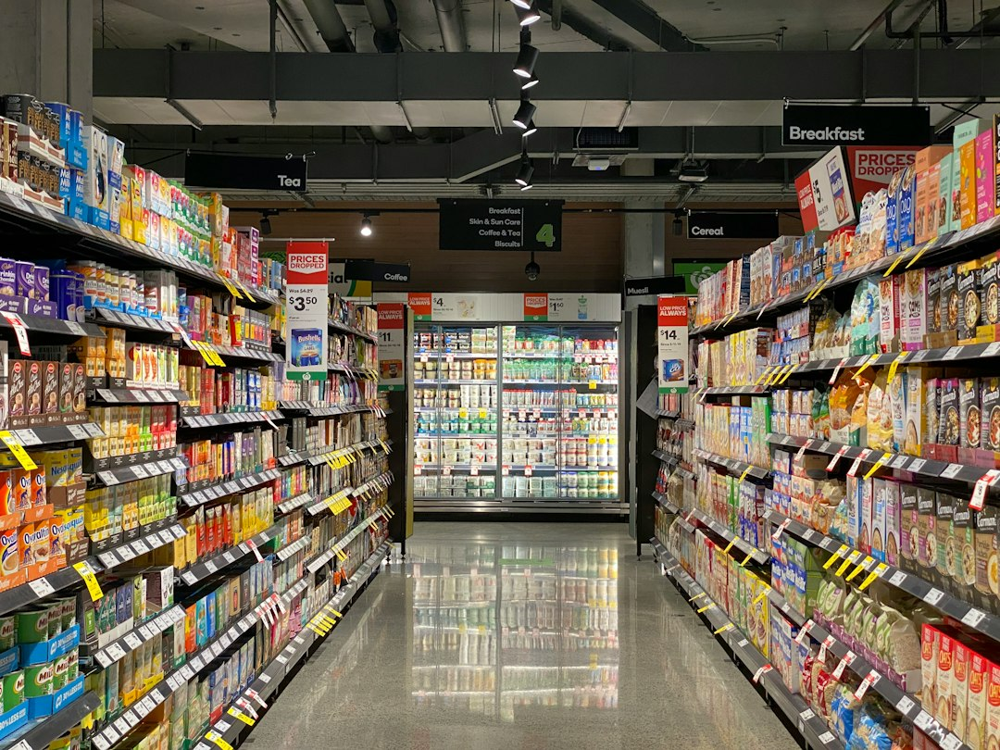

Nhiều người mới đầu tư thường bị mê hoặc bởi những công ty có doanh thu nghìn tỷ tăng trưởng 30% mỗi năm. Thế nhưng, doanh thu lớn chưa chắc đồng nghĩa với một cỗ máy in tiền khỏe mạnh.

Nếu bán 100 đồng sản phẩm mà tốn 95 đồng giá vốn, biên an toàn gần như bằng không. Chỉ cần giá nguyên liệu nhích nhẹ, toàn bộ khoản lãi sẽ bốc hơi ngay lập tức.

Để nhận diện doanh nghiệp thực sự nắm giữ quyền định giá, biên lợi nhuận gộp chính là trạm kiểm soát đầu tiên. Cùng **[Value Investing](/)** tìm hiểu biên lợi nhuận gộp là gì. Bài viết hướng dẫn công thức tính chuẩn xác và cách chọn lọc cổ phiếu.

## Biên lợi nhuận gộp là gì? Bản chất của tỷ suất lợi nhuận gộp

Biên lợi nhuận gộp có tên tiếng Anh là Gross Profit Margin. Đây là tỷ lệ phần trăm doanh thu còn lại sau khi trừ đi toàn bộ giá vốn hàng bán trực tiếp.

Chỉ số này cho biết doanh nghiệp giữ lại được bao nhiêu đồng tiền lời từ mỗi 100 đồng doanh thu tạo ra. Khoản tiền giữ lại này dùng để bù đắp các chi phí vận hành và tạo ra lợi nhuận ròng.

Hãy quan sát một ví dụ quen thuộc về quán phở bò trên đường phố Việt Nam. Bạn mở quán và bán một bát phở với mức giá 50.000 đồng.

Chi phí trực tiếp làm ra bát phở gồm bánh phở, thịt bò, xương hầm và gia vị là 25.000 đồng. Như vậy, lợi nhuận gộp trên mỗi bát phở là 25.000 đồng. Tỷ suất biên lợi nhuận gộp đạt mức 50%.

Khoản 25.000 đồng tiền lời gộp này là tấm đệm tài chính sống còn của bạn. Bạn dùng nó để trả tiền thuê mặt bằng, trả lương nhân viên bưng bê và thanh toán tiền điện nước.

Giả sử một quán khác cạnh tranh bằng cách hạ giá bán hoặc mua nguyên liệu đắt đỏ, khiến giá vốn lên tới 45.000 đồng. Biên lợi nhuận gộp của họ chỉ còn vỏn vẹn 10%.

Khi giá thịt bò ngoài chợ tăng thêm 5.000 đồng mỗi bát, quán phở thứ hai sẽ rơi vào cảnh thua lỗ ngay lập tức. Trong khi đó, quán của bạn vẫn đứng vững nhờ biên gộp dày dặn.

Biên lợi nhuận gộp phản ánh sức mạnh cạnh tranh sơ khai nhất của một sản phẩm. Nó cho thấy sản phẩm có thực sự tạo ra giá trị thặng dư trước khi tính đến các chi phí gián tiếp khác.

## Công thức và cách tính biên lợi nhuận gộp từ báo cáo tài chính

Để tính biên lợi nhuận gộp, bạn chỉ cần mở Báo cáo kết quả hoạt động kinh doanh của doanh nghiệp. Công thức tính toán được thiết lập như sau:

**Biên lợi nhuận gộp = (Lợi nhuận gộp / Doanh thu thuần) × 100%**

*Ảnh: Jakub Żerdzicki / Unsplash*

Trong công thức trên, Lợi nhuận gộp là chênh lệch giữa Doanh thu thuần và Giá vốn hàng bán. Công thức thành phần:

**Lợi nhuận gộp = Doanh thu thuần - Giá vốn hàng bán**

Doanh thu thuần là tổng số tiền thu được từ bán hàng sau khi trừ các khoản giảm trừ. Các khoản giảm trừ bao gồm chiết khấu thương mại, giảm giá hàng bán hoặc hàng bị trả lại.

Giá vốn hàng bán (COGS) là toàn bộ chi phí phát sinh trực tiếp để tạo ra sản phẩm. Đối với doanh nghiệp sản xuất, khoản mục này bao gồm ba yếu tố cốt lõi.

Yếu tố thứ nhất là chi phí nguyên vật liệu trực tiếp cấu thành nên thành phẩm. Yếu tố thứ hai là chi phí tiền lương trả cho công nhân trực tiếp sản xuất. Yếu tố thứ ba là chi phí sản xuất chung như khấu hao máy móc và tiền điện nhà xưởng.

Đối với các doanh nghiệp thương mại hoặc bán lẻ, giá vốn hàng bán đơn giản là giá mua hàng hóa từ nhà cung cấp. Nó cộng thêm chi phí vận chuyển hàng về kho lưu trữ.

Phương pháp hạch toán hàng tồn kho cũng tác động trực tiếp tới giá vốn. Doanh nghiệp áp dụng phương pháp nhập trước xuất trước sẽ có giá vốn thấp hơn trong thời kỳ lạm phát.

Điều này làm cho biên lợi nhuận gộp tăng lên tạm thời. Bạn cần đọc kỹ phần thuyết minh báo cáo tài chính để nắm rõ chính sách kế toán hàng tồn kho của doanh nghiệp.

| Chỉ tiêu trên Báo cáo kết quả kinh doanh | Mã số | Giá trị (Tỷ đồng) | Cách tính |
|---|---|---|---|
| Doanh thu bán hàng và cung cấp dịch vụ | 01 | 1.250 | Số liệu thực tế trên BCTC |
| Các khoản giảm trừ doanh thu | 02 | 50 | Hàng bán trả lại, giảm giá |
| **Doanh thu thuần về bán hàng** | **10** | **1.200** | **Mã 01 - Mã 02** |
| **Giá vốn hàng bán (COGS)** | **11** | **720** | **Chi phí sản xuất trực tiếp** |
| **Lợi nhuận gộp về bán hàng** | **20** | **480** | **Mã 10 - Mã 11** |
| **Biên lợi nhuận gộp (%)** | | **40.00%** | **(480 / 1.200) × 100%** |

Bảng ví dụ trên cho thấy cứ 100 đồng doanh thu thuần mang về, doanh nghiệp giữ lại được 40 đồng lợi nhuận gộp. Đây là tỷ lệ rất hấp dẫn đối với một công ty sản xuất công nghiệp.

## Ý nghĩa của biên lợi nhuận gộp trong đầu tư chứng khoán

Trong bộ môn **[phân tích cơ bản](/phan-tich/co-ban/phan-tich-co-ban-la-gi/)**, biên lợi nhuận gộp được coi là chiếc phong vũ biểu đo lường sức khỏe doanh nghiệp. Chỉ số này mang ba tầng ý nghĩa chiến lược sâu sắc.

*Ảnh: Franki Chamaki / Unsplash*

Ý nghĩa đầu tiên là thước đo quyền lực định giá (Pricing Power). Đây là thuật ngữ được nhà đầu tư huyền thoại Warren Buffett nhắc đến nhiều lần. Doanh nghiệp có quyền định giá là nơi có thể tăng giá bán mà không sợ mất khách hàng.

Khi lạm phát tăng cao, giá nguyên vật liệu đầu vào leo thang nhanh chóng. Công ty sở hữu thương hiệu mạnh sẽ tự tin tăng giá bán sản phẩm tương ứng. Nhờ vậy, biên lợi nhuận gộp của họ được bảo toàn nguyên vẹn.

Quyền lực định giá còn thể hiện qua khả năng giữ chân khách hàng trung thành. Một thương hiệu uy tín có thể tăng giá bán nhẹ mỗi năm. Người tiêu dùng vẫn tiếp tục chọn mua vì chất lượng đã được khẳng định.

Khoản chênh lệch giá bán này chảy thẳng vào lợi nhuận gộp của doanh nghiệp. Nó tạo ra nguồn tiền dồi dào để tiếp tục tài trợ cho hoạt động nghiên cứu phát triển.

Ý nghĩa thứ hai là tấm khiên che chắn rủi ro chu kỳ kinh tế. Doanh nghiệp có biên gộp dày dặn luôn có khả năng chống chịu bão táp tốt hơn. Họ có đủ dư địa lợi nhuận để vượt qua các đợt khủng hoảng suy thoái.

Ngược lại, các công ty có biên gộp mỏng manh dưới 8% rất dễ rơi vào tình trạng nguy cấp. Chỉ cần thị trường đóng băng hoặc nguyên liệu tăng nhẹ, họ sẽ lập tức bị ăn mòn hết tiền lời.

Ý nghĩa thứ ba là tín hiệu nhận diện con hào kinh tế bền vững. Doanh nghiệp duy trì biên gộp trên 40% suốt nhiều năm luôn sở hữu lợi thế cạnh tranh độc quyền. Lợi thế đó có thể là bí mật công nghệ, bằng sáng chế hoặc thương hiệu ăn sâu vào tâm trí khách hàng.

Khi biên gộp được bảo vệ vững chắc, công ty không phải tham gia vào các cuộc chiến hạ giá tự sát. Họ tập trung nguồn lực nâng cao giá trị sản phẩm cho người tiêu dùng.

Biên lợi nhuận gộp cao là điều kiện tiên quyết để tạo ra **[chỉ số ROIC](/phan-tich/co-ban/roic-la-gi/)** vượt trội. Lợi nhuận sản xuất dồi dào sẽ cung cấp nguồn vốn tái đầu tư mạnh mẽ cho công ty.

## Biên lợi nhuận gộp bao nhiêu là tốt? So sánh theo ngành tại Việt Nam

Một câu hỏi mà nhiều nhà đầu tư F0 thắc mắc là con số biên lợi nhuận gộp bao nhiêu thì đạt chuẩn. Câu trả lời phụ thuộc hoàn toàn vào mô hình kinh doanh của từng ngành nghề.

Mỗi ngành kinh tế có đặc thù về công nghệ sản xuất, vòng quay hàng tồn kho và mức độ cạnh tranh riêng biệt. Việc so sánh biên gộp giữa các ngành khác nhau là điều hoàn toàn sai lầm.

| Nhóm ngành trên sàn chứng khoán | Mã cổ phiếu tiêu biểu | Biên gộp trung bình | Đặc thù mô hình kinh doanh |
|---|---|---|---|
| Bán lẻ điện máy, tiêu dùng | MWG, FRT | 8% - 18% | Cạnh tranh giá gay gắt, biên mỏng nhưng vòng quay vốn nhanh |
| Thép, vật liệu xây dựng | HPG, HSG | 10% - 20% | Thâm dụng vốn lớn, phụ thuộc chu kỳ giá nguyên liệu thế giới |
| Hàng tiêu dùng, thực phẩm | VNM, MSN | 35% - 45% | Sở hữu thương hiệu mạnh, mạng lưới phân phối rộng khắp |
| Dược phẩm, chăm sóc sức khỏe | DHG, IMP | 40% - 50% | Rào cản công nghệ cao, tiêu chuẩn sản xuất khắt khe |
| Công nghệ phần mềm | FPT, CMG | 38% - 55% | Chi phí giá vốn thấp, giá trị gia tăng chủ yếu từ chất xám |

Ngành bán lẻ chấp nhận mức biên gộp khiêm tốn từ 10% đến 15%. Bù lại, họ sở hữu tốc độ quay vòng hàng tồn kho cực kỳ nhanh chóng. Một đồng vốn được quay vòng nhiều lần trong năm vẫn đem lại mức sinh lời lớn.

Ngược lại, ngành sữa hoặc dược phẩm đòi hỏi biên gộp cao trên 40%. Lý do là họ phải dành nhiều ngân sách cho nghiên cứu phát triển và quảng bá thương hiệu.

Quy tắc chuẩn mực là bạn chỉ nên so sánh biên gộp của doanh nghiệp với các đối thủ trực tiếp cùng ngành. Đồng thời, hãy theo dõi xu hướng tăng giảm của chỉ số này qua ít nhất 3 năm liên tiếp.

Biên lợi nhuận gộp mở rộng liên tục là bằng chứng cho thấy vị thế doanh nghiệp đang mạnh lên. Ngược lại, biên gộp thu hẹp dần cảnh báo áp lực cạnh tranh đang ngày một khốc liệt.

## Các cạm bẫy và lưu ý sống còn khi phân tích biên lợi nhuận gộp

Mặc dù biên lợi nhuận gộp là chỉ số rất giá trị, bạn không nên sử dụng nó một cách cô lập. Dưới đây là ba cạm bẫy phổ biến mà nhà đầu tư cá nhân cần lưu tâm.

Cạm bẫy thứ nhất là biên lợi nhuận gộp cao nhưng [biên lợi nhuận ròng](/phan-tich/co-ban/bien-loi-nhuan-rong/) lại âm. Một doanh nghiệp có thể bán sản phẩm với biên gộp lên tới 60%. Tuy nhiên, họ lại phải chi quá nhiều tiền cho hoa hồng đại lý và quảng cáo bán hàng.

Chi phí bán hàng và chi phí quản lý cồng kềnh sẽ nuốt chửng toàn bộ số tiền lời gộp. Cuối cùng, lợi nhuận sau thuế của công ty vẫn bị âm. Bạn luôn cần kiểm tra đồng thời cả biên gộp lẫn biên ròng.

Cạm bẫy thứ hai là ảo ảnh từ hàng tồn kho giá rẻ. Trong các đợt sốt giá hàng hóa, một số doanh nghiệp ghi nhận biên gộp tăng vọt trong một hoặc hai quý. Lý do là họ may mắn nhập được lô nguyên liệu giá rẻ từ trước đó.

Khi lượng tồn kho giá rẻ cạn kiệt, biên lợi nhuận gộp sẽ nhanh chóng rơi về mức bình thường. Bạn không nên nhầm lẫn hiện tượng đầu cơ ngắn hạn này với năng lực cạnh tranh cốt lõi của doanh nghiệp.

Cạm bẫy thứ ba là bỏ qua hiệu quả sử dụng nguồn vốn tổng thể. Biên lợi nhuận gộp cao chỉ là bước khởi đầu của chuỗi giá trị doanh nghiệp.

Bạn cần đối chiếu biên gộp với **[chỉ số ROE](/phan-tich/co-ban/roe-la-gi/)** và [hệ số thanh toán](/phan-tich/co-ban/he-so-thanh-toan-la-gi/) để kiểm tra tính an toàn của cỗ máy kinh doanh. Một công ty xuất sắc phải vừa có biên gộp dày, vừa duy trì thanh khoản lành mạnh.

Việc theo dõi biên lợi nhuận gộp giúp bạn nhận diện những doanh nghiệp thực sự có hào kinh tế bảo vệ. Đây là bước sàng lọc cốt lõi trong **[cách chọn cổ phiếu tốt](/dau-tu/co-phieu/cach-chon-co-phieu-tot/)** dài hạn.

Hãy mở ngay báo cáo tài chính của các doanh nghiệp bạn đang quan tâm và kiểm tra xu hướng biên gộp. Đó là cách tốt nhất để bạn bảo vệ nguồn vốn và gia tăng lợi nhuận đầu tư bền vững.
