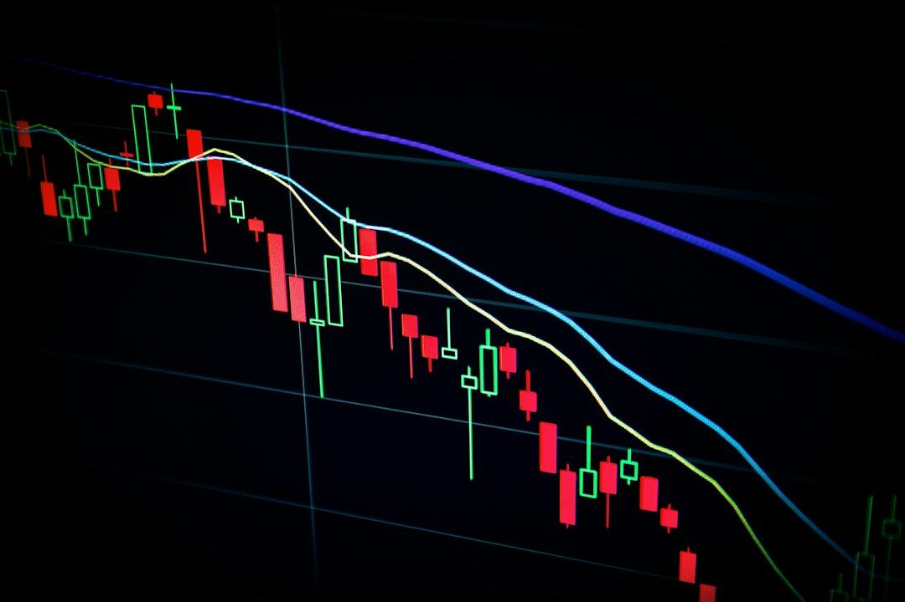

Gần như mọi tài liệu đều dạy rằng breakout phải đi kèm khối lượng lớn mới đáng tin. Nghiên cứu của Thomas Bulkowski trên hơn 8.000 mô hình giá lại cho kết quả ngược. Phá vỡ với khối lượng trên trung bình thất bại gần gấp 3 lần.

Bài này của **[Value Investing](/)** giải thích breakout trong chứng khoán là gì và cách xác nhận một cú phá vỡ thật. Các quy tắc chính đi kèm số liệu kiểm chứng thay vì kinh nghiệm truyền miệng.

Phần sau trình bày quy trình 4 bước có ví dụ giá cụ thể. Phần cuối nói về cách áp dụng với chu kỳ T+2 và biên độ giá ở thị trường Việt Nam.

## Breakout trong chứng khoán là gì?

Breakout (phá vỡ giá) là hiện tượng giá đóng cửa vượt ra ngoài một ngưỡng. Trước đó, giá đã từng 2–3 lần chạm ngưỡng này mà không vượt qua được. Ngưỡng đó có thể là kháng cự phía trên hoặc hỗ trợ phía dưới.

Breakout tăng xảy ra khi giá đóng cửa trên kháng cự. Breakout giảm xảy ra khi giá đóng cửa dưới hỗ trợ.

Hãy hình dung một quán phở đông khách luôn bán đúng 50.000 đồng một tô. Mấy lần chủ quán thử tăng lên 55.000 đồng, khách vắng hẳn nên lại hạ về giá cũ.

Mức 50.000 đồng chính là kháng cự. Đến khi giá thịt bò tăng và mọi quán quanh đó đều lên 55.000 đồng, khách vẫn ăn đều. Mức giá mới được chấp nhận, đó là một breakout.

## Các dạng breakout thường gặp

Ngưỡng bị phá vỡ quyết định cách bạn đo mục tiêu và đặt cắt lỗ. Bảng dưới tóm tắt 4 dạng phổ biến trên biểu đồ.

| Dạng breakout | Ngưỡng bị phá vỡ | Ví dụ mô hình |
|---|---|---|
| Phá vỡ ngưỡng ngang | Đỉnh hoặc đáy cũ nằm ngang | Vùng tích lũy hình chữ nhật, đỉnh lịch sử |
| Phá vỡ đường xu hướng | Đường nối các đỉnh thấp dần hoặc đáy cao dần | Kênh giá giảm, kênh giá tăng |
| Phá vỡ mô hình giá | Đường viền cổ hoặc cạnh mô hình | Vai đầu vai, 2 đáy, tam giác, cốc tay cầm |
| Phá vỡ vùng biến động hẹp | Dải biên độ co lại sau thời gian dài | Bollinger Bands thắt hẹp |

Mỗi mô hình giá thực chất kết thúc bằng một breakout. Với [mô hình 2 đáy](/phan-tich/ky-thuat/mo-hinh-2-day/), đó là phiên đóng cửa trên đỉnh giữa. Với [mô hình tam giác](/phan-tich/ky-thuat/mo-hinh-tam-giac/), đó là phiên đóng cửa ngoài một trong hai cạnh.

Với dạng cuối, dải [Bollinger Bands](/phan-tich/ky-thuat/chi-bao-bollinger-bands/) co hẹp là dấu hiệu giá sắp chọn hướng. Trạng thái này gọi là [Bollinger Band Squeeze](/phan-tich/ky-thuat/chi-bao-bollinger-band-squeeze-la-gi/).

Nếu chưa vững cách vẽ ngưỡng, bạn nên đọc bài [hỗ trợ kháng cự là gì](/phan-tich/ky-thuat/ho-tro-khang-cu-la-gi/) trước. Vẽ sai ngưỡng thì mọi tín hiệu phá vỡ phía sau đều sai.

## 3 tiêu chí xác nhận một breakout

Giá chạm hoặc vượt ngưỡng trong phiên chưa đủ để gọi là breakout. Ba tiêu chí dưới đây giúp bạn lọc bớt tín hiệu nhiễu.

- **Giá đóng cửa ngoài ngưỡng**. Bóng nến vượt kháng cự nhưng giá đóng cửa vẫn nằm dưới thì chưa tính. Giá đóng cửa phản ánh mức mà phe mua và phe bán chấp nhận cuối phiên.

- **Khoảng vượt đủ xa**. Đóng cửa trên kháng cự 0,2% rất dễ bị đẩy ngược ngay phiên sau. Value Investing gợi ý một bộ lọc đơn giản là vượt ít nhất 2% hoặc giữ trên ngưỡng 2 phiên liên tiếp.

- **Ngưỡng đã được kiểm chứng**. Ngưỡng có từ 2–3 lần chạm trở lên mới có ý nghĩa. Ngưỡng tự vẽ qua một điểm duy nhất thì phá vỡ cũng không mang thông tin gì.

### Khối lượng cao có phải luôn là tín hiệu tốt?

Đây là điểm mà dữ liệu đi ngược lời khuyên phổ biến. Bulkowski xét hơn 8.000 mô hình chữ nhật, 2 đỉnh, 2 đáy, 3 đỉnh và 3 đáy trên thị trường Mỹ giai đoạn 1991–2011.

Ông so khối lượng phiên phá vỡ với trung bình 31 ngày lịch trước đó. Kết quả được tóm tắt trong bảng dưới.

| Chỉ số (Bulkowski, VolumeStudy) | Khối lượng trên trung bình | Khối lượng dưới trung bình |
|---|---|---|
| Mức tăng trung bình sau phá vỡ lên | 37,6% | 35,8% |
| Tỷ lệ thất bại khi phá vỡ lên (tăng dưới 10%) | 14% | 5% |
| Tỷ lệ thất bại khi phá vỡ xuống (giảm dưới 10%) | 28% | 11% |
| Tỷ lệ có nhịp quay lại kiểm tra (throwback) | 57% | 18% |
| Tỷ lệ có nhịp hồi lại kiểm tra (pullback) | 47% | 17% |

Khối lượng lớn chỉ giúp mức tăng nhích thêm 1,8 điểm phần trăm. Đổi lại, tỷ lệ thất bại và tỷ lệ giá quay về ngưỡng cũ đều cao gấp 2–3 lần.

Cách đọc thực tế là khối lượng lớn không phải giấy bảo đảm. Phiên khối lượng đột biến thường có người chốt lời ngay. Bạn nên chuẩn bị cho nhịp quay lại thay vì mua đuổi toàn bộ vốn.

Nghiên cứu này dùng dữ liệu Mỹ và chỉ gồm 5 loại mô hình có ngưỡng nằm ngang. Bạn nên xem đây là lời nhắc thận trọng, không phải quy luật áp dụng nguyên vẹn cho mọi mã ở Việt Nam.

## Breakout giả và nhịp quay lại kiểm tra

Breakout giả (false breakout) là khi giá vượt ngưỡng rồi chỉ sau vài phiên đã quay ngược vào trong vùng cũ. Người mua đuổi ở phiên phá vỡ thường bị kẹt ở vùng giá cao nhất.

Cần phân biệt breakout giả với throwback. Throwback là nhịp giá quay về gần ngưỡng vừa phá vỡ rồi tiếp tục đi lên, còn với phá vỡ giảm thì gọi là pullback.

Bulkowski kiểm tra 9.372 trường hợp trên 841 cổ phiếu, thuộc 30 loại mô hình giá, giai đoạn 1991–2008. Ông chia throwback thành hai nhóm dựa trên giá thấp nhất của phiên phá vỡ.

| Loại nhịp quay lại (Bulkowski, ThrowPull) | Kết quả trung bình | Số mẫu |
|---|---|---|
| Throwback giữ trên đáy phiên phá vỡ | Tăng 41,3% | 1.717 |
| Throwback thủng đáy phiên phá vỡ | Tăng 26,7% | 3.311 |
| Pullback không vượt đỉnh phiên phá vỡ | Giảm 25,1% | 1.355 |
| Pullback vượt đỉnh phiên phá vỡ | Giảm 17,3% | 2.989 |

Giá thấp nhất của phiên phá vỡ là mốc để phân loại. Throwback giữ được mốc này cho mức tăng cao hơn khoảng 15 điểm phần trăm so với nhóm thủng mốc.

Bulkowski còn so sánh hai cách đặt cắt lỗ. Cách đặt cắt lỗ sát dưới đáy phiên phá vỡ rồi mới chuyển sang cắt lỗ động cho lợi nhuận gộp cao hơn 11%. Nhóm so sánh chỉ dùng cắt lỗ động ngay từ đầu.

## Cách giao dịch breakout qua 4 bước

Quy trình dưới đây áp dụng cho breakout tăng với cổ phiếu cơ sở. Breakout giảm được dùng để hạ tỷ trọng, sẽ nói ở phần sau.

1. **Xác định ngưỡng trước khi giá chạm tới**. Đánh dấu kháng cự có ít nhất 2–3 lần chạm. Ghi trước giá phá vỡ, giá mục tiêu và mức cắt lỗ.

2. **Chờ phiên đóng cửa xác nhận**. Giá phải đóng cửa vượt ngưỡng theo bộ lọc bạn đã chọn. Không đặt lệnh trong phiên chỉ vì giá vừa nhích qua kháng cự.

3. **Chia vốn thành 2 phần**. Mua phần đầu sau phiên xác nhận. Phần còn lại dành cho nhịp throwback nếu giá quay về gần ngưỡng mà vẫn giữ trên đáy phiên phá vỡ.

4. **Đặt cắt lỗ dưới đáy phiên phá vỡ**. Giá đóng cửa thủng mốc này là dấu hiệu breakout yếu hoặc giả. Khi giá tăng xa, nâng dần mức cắt lỗ theo đường trung bình hoặc đáy gần nhất.

*Ảnh: Maxim Hopman / Unsplash*

Ví dụ giả định: cổ phiếu F tích lũy 6 tuần trong vùng 22.500–25.000 đồng. Giá chạm 25.000 đồng ba lần nhưng đều bị đẩy xuống.

Một phiên, cổ phiếu F đóng cửa ở 25.600 đồng, vượt kháng cự 2,4%. Giá thấp nhất của phiên đó là 24.900 đồng.

Chiều cao vùng tích lũy là 25.000 − 22.500 = 2.500 đồng. Giá mục tiêu theo cách đo phổ biến là **25.000 + 2.500 = 27.500 đồng**.

### Tính tỷ lệ lời/lỗ trước khi đặt lệnh

Mua ở 25.600 đồng, cắt lỗ ở 24.800 đồng, ngay dưới đáy phiên phá vỡ. Rủi ro là 800 đồng mỗi cổ phiếu.

Phần lời kỳ vọng tới mục tiêu là 27.500 − 25.600 = 1.900 đồng. Tỷ lệ lời/lỗ khoảng **1.900 / 800 ≈ 2,4 lần**.

Nếu tỷ lệ này dưới 1,5 lần, bạn có thể bỏ qua tín hiệu. Bạn không cần tham gia mọi cú phá vỡ, chỉ cần tham gia những cú có rủi ro hợp lý.

## Áp dụng breakout ở thị trường Việt Nam

Quy tắc kỹ thuật giống nhau ở mọi thị trường, nhưng luật giao dịch thì khác. Bốn điểm dưới đây ảnh hưởng trực tiếp tới cách bạn giao dịch breakout ở Việt Nam.

- **Chu kỳ thanh toán T+2**. Cổ phiếu mua phiên T chỉ về tài khoản chiều ngày T+2. Nếu breakout giả xảy ra trong hai phiên này, bạn chưa bán được để cắt lỗ.

- **Biên độ giá theo sàn**. HOSE giới hạn 7%, HNX 10% và UPCoM 15% mỗi phiên. Một breakout có thể kéo giá lên trần ngay phiên đầu, mua đuổi ở giá trần đẩy mức cắt lỗ ra xa.

- **Phiên ATC quyết định giá đóng cửa**. Giá đóng cửa trên HOSE và HNX được xác định trong phiên khớp lệnh định kỳ cuối ngày. Giá vượt kháng cự lúc 14 giờ vẫn có thể bị kéo về trong phiên ATC.

- **Không bán khống cổ phiếu cơ sở**. Breakout giảm vì vậy là tín hiệu hạ tỷ trọng hoặc [cắt lỗ](/dau-tu/co-phieu/cat-lo-la-gi/) với người đang giữ. Người chưa có cổ phiếu chỉ cần đứng ngoài.

Chi tiết biên độ từng sàn có trong bài [biên độ giao dịch chứng khoán](/dau-tu/co-phieu/bien-do-giao-dich-chung-khoan/). Khi mua sau phiên xác nhận, hãy dùng [lệnh giới hạn](/dau-tu/co-phieu/cac-loai-lenh-trong-chung-khoan/) để không bị khớp quá xa điểm phá vỡ.

## 4 lỗi thường gặp khi giao dịch breakout

Breakout trông đơn giản trên biểu đồ quá khứ. Khi giao dịch thật, bốn lỗi dưới đây lặp lại thường xuyên ở nhà đầu tư mới.

1. **Mua trong phiên trước khi đóng cửa**. Giá vượt kháng cự lúc 10 giờ sáng chưa phải breakout. Bạn có thể bị kẹt nếu phiên chiều giá quay đầu.

2. **Mua đuổi toàn bộ vốn ở phiên khối lượng đột biến**. Theo Bulkowski, 57% phá vỡ khối lượng cao có nhịp quay lại. Chia vốn giúp bạn có giá vốn hợp lý hơn.

3. **Đặt cắt lỗ quá xa hoặc không đặt**. Với cổ phiếu F, cắt lỗ ở đáy vùng 22.500 đồng đẩy rủi ro lên 3.100 đồng, gấp gần 4 lần. Đáy phiên phá vỡ là mốc gần hơn và có dữ liệu ủng hộ.

4. **Giao dịch trên mã thanh khoản thấp**. Vài lệnh lớn đủ tạo một breakout giả trên mã chỉ khớp vài chục nghìn cổ phiếu mỗi phiên. Ưu tiên mã có giá trị khớp lệnh ổn định.

Một lỗi khác ít người để ý là vẽ lại ngưỡng sau khi giá đã chạy. Hãy chụp màn hình biểu đồ kèm ngưỡng trước khi phá vỡ, để không tự biện minh cho tín hiệu sai.

## Bước tiếp theo bạn có thể làm ngay

Insight cốt lõi là: breakout chỉ là điểm bắt đầu, không phải lời xác nhận. Đáy phiên phá vỡ mới là mốc cho bạn biết tín hiệu còn giá trị hay không.

Bước tiếp theo bạn có thể làm ngay: mở biểu đồ ngày của một cổ phiếu đang đi ngang dưới một kháng cự. Ghi sẵn giá phá vỡ, giá mục tiêu, mức cắt lỗ và tỷ lệ lời/lỗ trước khi giá chạm tới.

Breakout xuất hiện ở cuối mô hình đảo chiều như [mô hình vai đầu vai](/phan-tich/ky-thuat/mo-hinh-vai-dau-vai/). Nó cũng kết thúc mô hình tiếp diễn như [cốc tay cầm](/phan-tich/ky-thuat/mo-hinh-coc-tay-cam/). Bạn muốn luyện nhận diện breakout với mô hình nào trước?

---
*Bài viết mang tính giáo dục, không phải khuyến nghị mua hoặc bán bất kỳ cổ phiếu nào. Cổ phiếu F là ví dụ giả định. Mô hình kỹ thuật chỉ phản ánh xác suất, bạn tự chịu trách nhiệm với quyết định đầu tư của mình.*
