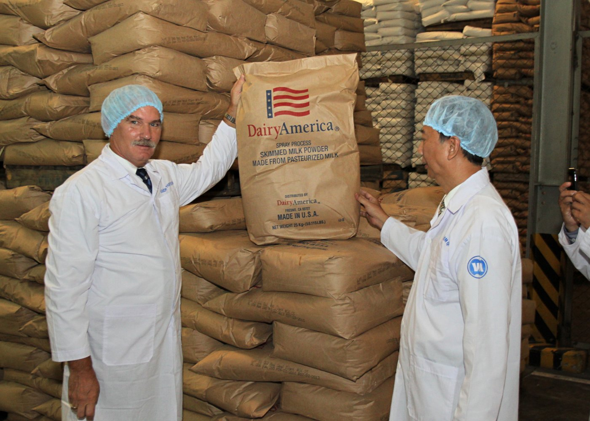
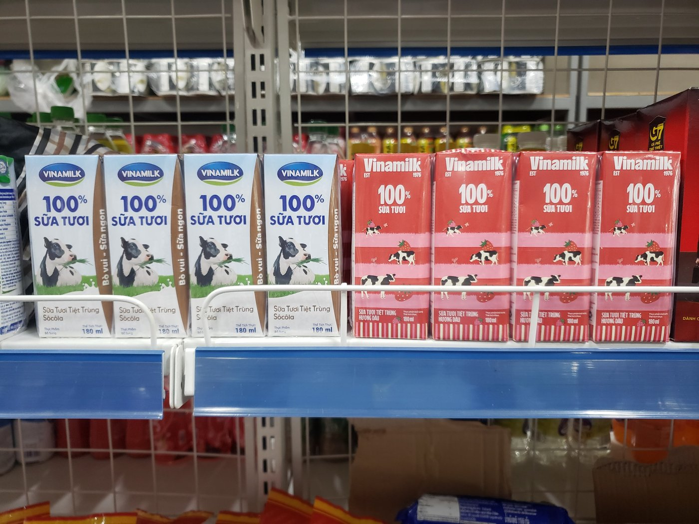

Đối với những ai tìm kiếm sự ổn định và dòng thu nhập thụ động đều đặn từ chứng khoán, Vinamilk luôn là biểu tượng mẫu mực của một cỗ máy in tiền mặt. Là thương hiệu quốc gia quen thuộc trong mọi gia đình Việt Nam, cổ phiếu VNM mang đến sự bình yên hiếm có giữa những cơn sóng biến động của thị trường. Bài viết này từ **[Value Investing](/)** hướng dẫn chi tiết cách mua cổ phiếu Vinamilk từ số vốn ban đầu, cách đặt lệnh trên ứng dụng đến chiến lược đầu tư nhận cổ tức tiền mặt dài hạn cho người mới.

## Cổ phiếu Vinamilk là gì và niêm yết trên sàn nào?

Hiểu rõ lợi thế kinh doanh của doanh nghiệp là nền tảng giúp bạn tự tin nắm giữ cổ phần lâu dài.

Cổ phiếu Vinamilk là chứng chỉ xác nhận quyền sở hữu một phần Công ty Cổ phần Sữa Việt Nam. Doanh nghiệp này chiếm hơn 50% thị phần ngành sữa trong nước với hệ thống trang trại chuẩn quốc tế và mạng lưới phân phối rộng khắp toàn quốc. Trong khái niệm **[cổ phiếu là gì](/dau-tu/co-phieu/co-phieu-la-gi/)**, việc nắm giữ VNM đồng nghĩa với việc bạn chia sẻ lợi nhuận từ hàng triệu hộp sữa được tiêu thụ mỗi ngày.

Cổ phiếu Vinamilk được niêm yết chính thức trên sàn HOSE với mã giao dịch là `VNM`.

Mã VNM là trụ cột lâu năm trong nhóm VN30 và là ví dụ tiêu biểu nhất của [cổ phiếu phòng thủ](/dau-tu/co-phieu/co-phieu-phong-thu/). Do sữa là mặt hàng tiêu dùng thiết yếu, kết quả kinh doanh của Vinamilk ít bị ảnh hưởng bởi các chu kỳ kinh tế suy thoái so với các ngành bất động sản hay vật liệu xây dựng.

*Ảnh: Dây chuyền chế biến sữa tại nhà máy Vinamilk. Nguồn: USDA / Wikimedia Commons*

## Mua cổ phiếu Vinamilk cần tối thiểu bao nhiêu tiền?

Thị giá của Vinamilk rất phù hợp với ngân sách tích lũy định kỳ của đa số nhân viên văn phòng.

Sàn HOSE quy định lô giao dịch chuẩn là 100 cổ phiếu. Giả sử tại thời điểm giao dịch, thị giá của VNM trên bảng điện tử đang ở mức 68.000 đồng/cổ phiếu.

Bảng tính chi phí mua 1 lô chẵn 100 cổ phiếu VNM được thể hiện cụ thể:

| Khoản mục chi phí | Công thức tính toán | Số tiền thực tế (VNĐ) |
| :--- | :--- | :--- |
| **Giá trị 100 cổ phiếu VNM** | 100 × 68.000 đồng | 6.800.000 đ |
| **Phí giao dịch chứng khoán** | 6.800.000 đ × 0,1% | 6.800 đ |
| **Tổng số tiền cần có trong tài khoản** | Tiền mua + Phí giao dịch | **6.806.800 đ** |

Như vậy, bạn chỉ cần chuẩn bị khoảng 6,8 triệu đồng là đã có thể sở hữu trọn vẹn 100 cổ phiếu của thương hiệu sữa lớn nhất Việt Nam.

Nếu muốn bắt đầu làm quen với số tiền nhỏ hơn, bạn có thể mua lô lẻ từ 1 đến 99 cổ phiếu trên app. Chỉ với khoảng 680.000 đồng, bạn đã có thể mua thử nghiệm 10 cổ phiếu VNM vào danh mục tài sản cá nhân.

## Hướng dẫn 4 bước đặt lệnh mua cổ phiếu VNM trên App

Quy trình thao tác đặt lệnh mua VNM trên điện thoại diễn ra rất trực quan theo cẩm nang **[cách mua cổ phiếu](/dau-tu/co-phieu/cach-mua-co-phieu/)** bài bản.

### Bước 1: Đăng nhập app chứng khoán và nạp tiền

Mở ứng dụng chứng khoán mà bạn đã đăng ký tài khoản (chẳng hạn TCBS, SSI, VPS hoặc DNSE). Chuyển tiền từ ngân hàng vào tài khoản giao dịch chứng khoán và kiểm tra số dư tiền mặt khả dụng trên tiểu khoản thường.

### Bước 2: Tìm kiếm mã chứng khoán VNM

Tại ô tìm kiếm của ứng dụng, bạn gõ 3 chữ cái `VNM`. Màn hình sẽ hiển thị bảng giá khớp lệnh, biểu đồ kỹ thuật và sổ lệnh trực tiếp của cổ phiếu Vinamilk trên sàn HOSE.

### Bước 3: Đặt lệnh mua với mức giá mong muốn

*Ảnh: Thao tác đặt lệnh mua cổ phiếu VNM trên ứng dụng chứng khoán. Nguồn: Unsplash*

Bấm vào nút "Mua" màu xanh lá cây. 

Tại mục Loại lệnh, bạn hãy chọn lệnh Giới hạn (lệnh LO) để đảm bảo không bị mua với giá cao bất thường.

Tại ô Khối lượng, bạn nhập số lượng cần mua (ví dụ `100`).

Tại ô Mức giá, bạn quan sát cột Bên bán. Nếu muốn mua khớp lệnh ngay, bạn hãy đặt bằng mức giá chào bán 1. Nếu muốn mua với mức giá chiết khấu hơn, bạn có thể đặt thấp hơn một vài bước giá và kiên nhẫn chờ đợi.

### Bước 4: Xác thực và hoàn tất giao dịch

Kiểm tra lại toàn bộ thông tin mã chứng khoán VNM, số lượng và tổng số tiền thanh toán. 

Bấm nút "Xác nhận" và nhập mã Smart OTP hoặc mã PIN. Lệnh mua của bạn sẽ được gửi thẳng lên sàn HOSE. Khi lệnh khớp thành công, bạn chỉ cần chờ cổ phiếu về tài khoản sau chu kỳ thanh toán T+1.5 để quản lý.

## Lợi thế độc quyền: Cỗ máy in cổ tức tiền mặt bền bỉ

Điểm khác biệt lớn nhất của Vinamilk so với các mã tăng trưởng như [cách mua cổ phiếu FPT](/dau-tu/co-phieu/cach-mua-co-phieu-fpt/) hay [cách mua cổ phiếu Hòa Phát](/dau-tu/co-phieu/cach-mua-co-phieu-hoa-phat/) nằm ở dòng tiền cổ tức mặt cực kỳ dồi dào.

* **Tỷ lệ chi trả cổ tức bằng tiền mặt vượt trội**. Mỗi năm, Vinamilk dành phần lớn lợi nhuận sau thuế tạo ra để chia lại tiền mặt trực tiếp cho cổ đông. Mức chi trả thường đạt từ 3.000 đến 4.000 đồng cho mỗi cổ phiếu sở hữu. Tìm hiểu sâu về [cổ tức là gì](/dau-tu/co-phieu/co-tuc-la-gi/) giúp bạn nhận ra sức mạnh của dòng tiền đều đặn này.

* **Tỷ suất cổ tức hấp dẫn hơn lãi suất tiết kiệm**. Với mức giá mua quanh 65.000 đến 70.000 đồng, tỷ suất sinh lời từ cổ tức tiền mặt hàng năm của VNM thường đạt từ 5% đến 6%. Con số này hoàn toàn tương đương hoặc cao hơn lãi suất tiền gửi ngân hàng, trong khi bạn vẫn giữ nguyên cơ hội tăng giá vốn khi doanh nghiệp mở rộng thị trường xuất khẩu.

* **Cơ cấu vốn sạch bóng nợ vay tài chính**. Vinamilk sở hữu lượng tiền gửi ngân hàng lên tới hàng chục nghìn tỷ đồng, hoàn toàn không chịu áp lực trả lãi vay khi lãi suất điều hành tăng cao.

*Ảnh: Các sản phẩm sữa tươi và dinh dưỡng quen thuộc của thương hiệu Vinamilk. Nguồn: Wikimedia Commons*

## Chiến lược đầu tư cổ phiếu Vinamilk dài hạn

Để tối ưu hóa lợi ích khi đầu tư vào VNM, bạn hãy áp dụng các nguyên tắc sau.

* **Mua tích sản và tái đầu tư cổ tức tiền mặt**. Mỗi khi nhận được tiền cổ tức được chuyển thẳng vào tài khoản chứng khoán, bạn hãy dùng chính số tiền đó để mua thêm cổ phiếu VNM. Chu trình tái đầu tư này tạo ra hiệu ứng lãi kép thần kỳ, giúp số lượng cổ phần của bạn tự động gia tăng theo thời gian.

* **Tận dụng giai đoạn thị trường chán nản để tích lũy**. Khi thị trường hưng phấn tìm kiếm các mã đầu cơ tăng nóng, cổ phiếu phòng thủ như VNM thường đi ngang tích lũy. Đây chính là cơ hội tuyệt vời để nhà đầu tư giá trị gom mua cổ phiếu với định giá an toàn và biên an toàn cao.

* **Xây dựng danh mục cân bằng cùng các mã trụ cột**. Bạn có thể kết hợp VNM với các cổ phiếu đầu ngành khác như [cách mua cổ phiếu Vietcombank](/dau-tu/co-phieu/cach-mua-co-phieu-vcb/) để tạo ra một danh mục đầu tư vừa có sự vững chãi phòng thủ, vừa có dòng tiền cổ tức đều đặn hàng quý.

Trang bị **[cách đầu tư cổ phiếu](/dau-tu/co-phieu/cach-dau-tu-co-phieu/)** bài bản giúp bạn tự tin xây dựng sự thịnh vượng tài chính một cách thanh thản. Hãy mở ứng dụng chứng khoán và thử đặt lệnh mua 100 cổ phiếu Vinamilk đầu tiên ngay trong phiên hôm nay.
