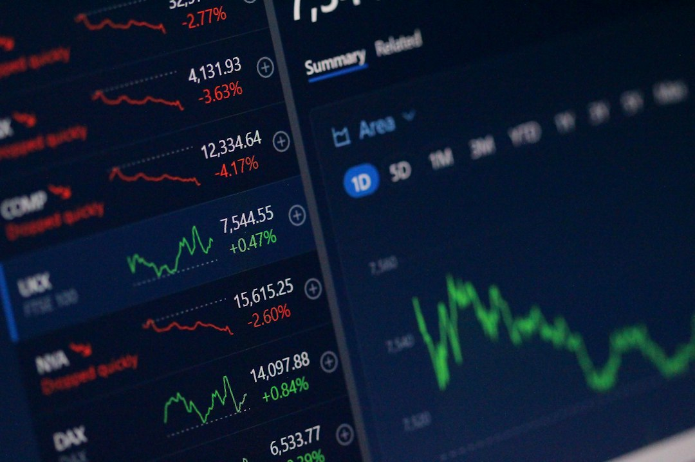

Nhiều người thấy hai dải Bollinger co sát nhau là vội mua, vì tin giá sắp bật lên. Sự thật là Bollinger Band Squeeze chỉ báo trước một đợt biến động lớn. Nó không cho biết giá sẽ đi lên hay đi xuống.

Bài này của **[Value Investing](/)** giải thích Bollinger Band Squeeze là gì, cách đo bằng chỉ báo BandWidth và cách chờ tín hiệu phá vỡ. Bạn cũng sẽ biết cách tránh cú phá vỡ giả mà chính John Bollinger đã cảnh báo.

Phần cuối nói về những điểm cần chỉnh khi áp dụng ở thị trường Việt Nam, nơi có biên độ 7% và chu kỳ T+2.

## Bollinger Band Squeeze là gì?

Bollinger Band Squeeze (co thắt Bollinger) là giai đoạn hai dải của [Bollinger Bands](/phan-tich/ky-thuat/chi-bao-bollinger-bands/) co hẹp bất thường. Hiện tượng này xảy ra khi biến động giá giảm xuống mức thấp so với lịch sử của chính cổ phiếu đó. Nhà đầu tư Việt Nam hay gọi nó là thắt nút cổ chai.

Ý tưởng gốc đến từ John Bollinger, người tạo ra chỉ báo vào đầu thập niên 1980. Theo ông, giai đoạn biến động thấp thường được nối tiếp bởi giai đoạn biến động cao, và ngược lại. Squeeze là dấu hiệu thị trường đang ở cuối pha yên lặng.

Trong pha yên lặng, bên mua và bên bán gần như cân bằng nên giá chỉ nhích quanh một mức. Thế cân bằng đó sớm muộn sẽ bị phá khi có tin tức hoặc dòng tiền lớn.

Hãy thử nghĩ thế này. Xe máy dồn lại trước đèn đỏ ở một ngã tư đông. Bạn biết chắc khi đèn xanh bật, cả dòng xe sẽ lao đi.

Nhưng đứng từ xa, bạn không biết đa số sẽ rẽ trái hay rẽ phải. Squeeze giống hệt vậy: nó báo lúc nào giá sắp chạy, không báo giá chạy về đâu.

## Cách đo Squeeze bằng chỉ báo BandWidth

Nhìn bằng mắt rất dễ đánh giá sai mức co hẹp. Vì vậy Bollinger dùng chỉ báo BandWidth (độ rộng dải) để đo bằng con số. Công thức theo StockCharts ChartSchool như sau:

**BandWidth = (Dải trên − Dải dưới) / Dải giữa × 100**

Dải giữa là đường trung bình 20 phiên, hai dải ngoài cách dải giữa 2 độ lệch chuẩn. Đây là thông số mặc định (20, 2) trên hầu hết phần mềm biểu đồ.

BandWidth càng nhỏ thì hai dải càng sát nhau. Theo tiêu chí Bollinger đưa ra, Squeeze xuất hiện khi BandWidth xuống mức thấp nhất khoảng 6 tháng, tương đương chừng 125 phiên giao dịch.

### Ví dụ tính BandWidth với cổ phiếu giả định

Giả sử cổ phiếu A đang giao dịch quanh 25.000 đồng. Bảng dưới so sánh hai thời điểm cách nhau vài tháng.

| Thời điểm | Dải trên | Dải giữa | Dải dưới | BandWidth |
|---|---|---|---|---|
| Tháng 3 (giá dao động mạnh) | 28.000 đ | 25.000 đ | 22.000 đ | 24 |
| Tháng 8 (giá đi ngang) | 26.000 đ | 25.000 đ | 24.000 đ | 8 |

Tháng 3, khoảng cách hai dải là 6.000 đồng, nên BandWidth bằng 6.000 / 25.000 × 100 = 24. Tháng 8, khoảng cách chỉ còn 2.000 đồng, BandWidth giảm xuống 8.

Con số 8 chưa nói lên điều gì nếu đứng một mình. Nếu đó là mức thấp nhất của cổ phiếu A trong 6 tháng qua, bạn đang thấy một Squeeze. Một mã khác có thể bình thường đã dao động ở BandWidth 5, nên ngưỡng luôn phải so với lịch sử của chính mã đó.

## Cách nhận diện Bollinger Band Squeeze trên biểu đồ

Bạn có thể kiểm tra 4 dấu hiệu sau trên bất kỳ app chứng khoán nào có Bollinger Bands.

1. **Hai dải co sát vào đường giữa**. Khoảng cách dải trên và dải dưới hẹp hơn hẳn các tháng trước.
2. **BandWidth chạm đáy khoảng 6 tháng**. Thêm chỉ báo BandWidth vào biểu đồ, kéo về 125 phiên gần nhất để so.
3. **Nến thân nhỏ, đi ngang**. Giá dao động trong biên hẹp, ít phiên tăng hay giảm quá 2%.
4. **Khối lượng cạn dần**. Thanh khoản thấp hơn trung bình 20 phiên, cho thấy hai phe mua và bán đang chờ.

*Ảnh: Anne Nygård / Unsplash*

Đủ cả 4 dấu hiệu chưa có nghĩa là bạn nên vào lệnh. Nó chỉ cho biết cổ phiếu này đáng đưa vào danh sách theo dõi trong vài tuần tới.

Squeeze có thể kéo dài từ vài phiên đến vài tháng. Không có quy tắc nào cho biết chính xác phiên nào giá sẽ phá vỡ.

## Cách giao dịch khi Squeeze xuất hiện

Theo StockCharts, chiến lược Squeeze ở dạng đơn giản nhất mang tính trung lập về hướng. Bạn không đoán trước, mà chờ giá tự chọn hướng rồi mới đi theo.

1. **Đánh dấu vùng tích lũy**. Kẻ hai đường ngang tại đỉnh và đáy của giai đoạn đi ngang. Đây là vùng giá cần bị phá.
2. **Chờ nến đóng cửa ngoài dải**. Giá đóng cửa trên dải trên gợi ý xu hướng tăng. Đóng cửa dưới dải dưới gợi ý xu hướng giảm.
3. **Xác nhận bằng khối lượng và BandWidth**. Phiên phá vỡ nên có khối lượng cao hơn trung bình 20 phiên. BandWidth phải bắt đầu mở rộng trở lại.
4. **Đặt điểm cắt lỗ trước khi mua**. Mức cắt lỗ thường đặt dưới dải giữa hoặc dưới đáy vùng tích lũy.

Giả sử cổ phiếu A phá lên 26.300 đồng với khối lượng gấp 2 lần trung bình. Bạn mua 100 cổ phiếu, tổng 2.630.000 đồng, và đặt cắt lỗ ở 24.800 đồng, dưới dải giữa. Rủi ro tối đa là 150.000 đồng, chưa tính phí.

Khi đã có vị thế, dải trên đi lên cùng giá là dấu hiệu xu hướng còn khỏe. Nếu giá đóng cửa quay lại dưới dải giữa, đó là lúc xem xét chốt hoặc cắt.

Với chiều phá xuống, người chỉ mua cổ phiếu như phần lớn nhà đầu tư cá nhân Việt Nam không bán khống được. Tín hiệu này khi đó dùng để tránh mua mới hoặc giảm tỷ trọng mã đang nắm.

### Head fake – cú phá vỡ giả sau Squeeze

Trong cuốn Bollinger on Bollinger Bands (2001), John Bollinger mô tả hiện tượng head fake. Giá phá một dải theo một hướng, chạy một đoạn ngắn, rồi quay đầu và chạy mạnh theo hướng ngược lại.

Ví dụ, cổ phiếu A vọt lên trên dải trên trong 1 phiên, nhiều người mua đuổi. Hai phiên sau giá rơi về dưới dải dưới và bắt đầu đợt giảm thật sự. Người mua đuổi bị kẹt ở vùng giá cao nhất.

Head fake xảy ra vì nhiều người cùng nhìn một Squeeze và cùng đặt lệnh ở mép vùng tích lũy. Cú phá vỡ đầu tiên kích hoạt các lệnh đó, rồi tạo lực ngược khi người mua đuổi bắt đầu cắt lỗ.

Cách giảm rủi ro là chờ nến đóng cửa xác nhận, không mua khi giá chỉ chạm dải trong phiên. Nếu giá quay lại vào trong vùng tích lũy sau 1–2 phiên, hãy coi tín hiệu đã hỏng và đứng ngoài. Bài về [breakout giả](/phan-tich/ky-thuat/breakout-trong-chung-khoan-la-gi/) có thêm các bộ lọc xác nhận bạn có thể áp dụng chung.

## Squeeze Bollinger và TTM Squeeze khác nhau thế nào?

Khi tìm hiểu Squeeze, bạn sẽ gặp thêm TTM Squeeze trên TradingView và nhiều phần mềm khác. Đây là biến thể do John Carter phát triển, đo co thắt theo cách khác Bollinger.

| Tiêu chí | Squeeze Bollinger | TTM Squeeze |
|---|---|---|
| Người phát triển | John Bollinger | John Carter |
| Cách xác định | BandWidth thấp nhất khoảng 6 tháng | Dải Bollinger nằm trọn bên trong Keltner Channel |
| Cách hiển thị | Đường BandWidth dưới biểu đồ giá | Chấm đánh dấu và histogram động lượng |
| Gợi ý hướng | Không, chờ giá phá dải | Có histogram động lượng để tham khảo hướng |
| Phù hợp | Người muốn hiểu gốc của chỉ báo | Người muốn tín hiệu bật/tắt dễ nhìn |

Keltner Channel là kênh giá dựa trên biến động trung bình thực (ATR) thay vì độ lệch chuẩn. Khi dải Bollinger lọt vào trong kênh Keltner, biến động đang thấp hơn mức thông thường.

Cả hai cách đều không loại bỏ được head fake. TTM Squeeze chỉ giúp bạn thấy trạng thái co thắt nhanh hơn trên màn hình.

## Lưu ý khi dùng Squeeze ở thị trường Việt Nam

Hầu hết tài liệu về Squeeze viết cho thị trường Mỹ, nơi giá có thể chạy tự do trong ngày. Ở Việt Nam, ba đặc điểm sau làm thay đổi cách áp dụng.

- **Biên độ 7% trên HOSE**. Cú bùng nổ sau Squeeze có thể bị chặn ở giá trần và kéo dài nhiều phiên, nên bạn khó mua được ở phiên đầu. Quy định [biên độ giao dịch](/dau-tu/co-phieu/bien-do-giao-dich-chung-khoan/) khác nhau trên từng sàn.

- **Chu kỳ T+2**. Cổ phiếu mua hôm nay phải chờ về tài khoản mới bán được, nên gặp head fake ngay thì bạn không thoát kịp. Chờ thêm một phiên xác nhận thường an toàn hơn mua ngay.

- **Cổ phiếu thanh khoản thấp**. Mã chỉ khớp vài chục nghìn cổ phiếu mỗi phiên dễ có BandWidth thấp do không ai giao dịch. Đây là co hẹp giả, không phải năng lượng đang tích tụ.

Squeeze cho kết quả đáng tin hơn khi trùng với một cấu trúc giá khác. Ví dụ, giai đoạn co thắt nằm trong [mô hình tam giác](/phan-tich/ky-thuat/mo-hinh-tam-giac/) hoặc ngay dưới một vùng kháng cự đã thử nhiều lần.

## Bước tiếp theo bạn có thể làm ngay

Điều cốt lõi cần nhớ: Squeeze cho biết lúc nào giá có thể chạy, không cho biết giá chạy về hướng nào. Lợi thế đến từ việc chờ xác nhận, không đến từ việc đoán trước.

Bước tiếp theo bạn có thể làm ngay là mở app chứng khoán, thêm Bollinger Bands (20, 2) và BandWidth vào biểu đồ. Tìm 3 cổ phiếu có BandWidth đang ở đáy 6 tháng, rồi ghi lại hướng phá vỡ của từng mã trong 4 tuần tới.

Sau khi giá đã phá vỡ, bạn sẽ cần biết nhịp điều chỉnh có thể về đâu. Bài [Fibonacci thoái lui](/phan-tich/ky-thuat/fibonacci-thoai-lui/) hướng dẫn cách đo vùng giá đó. Bạn đã thấy cổ phiếu nào trong danh mục đang co thắt chưa?
