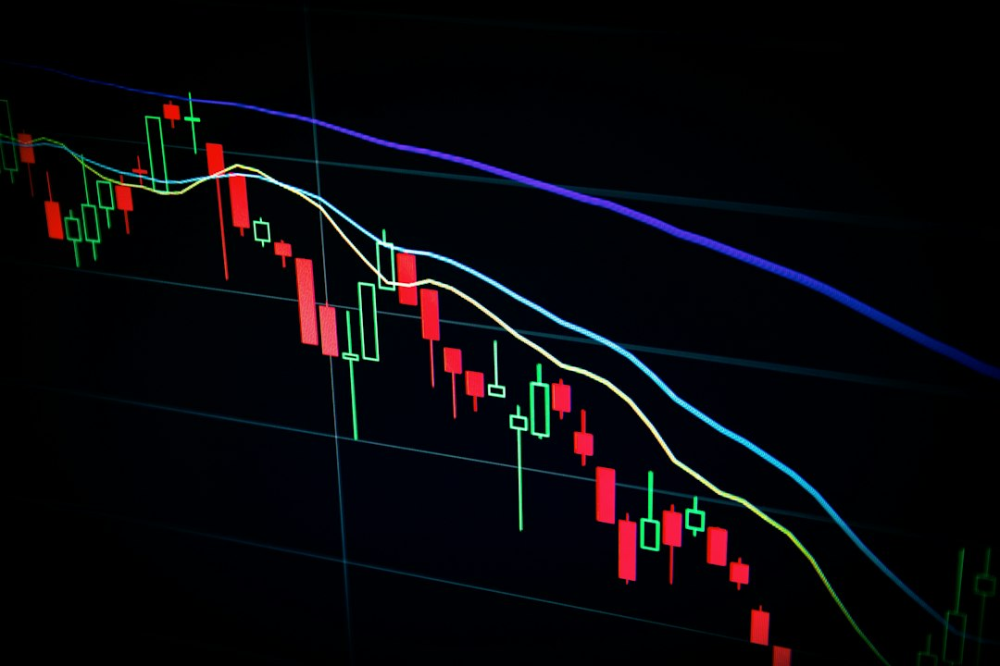

RSI của cổ phiếu bạn theo dõi loanh quanh 45–60 suốt cả tháng, không chạm 70 cũng không về 30. Chỉ báo im lặng, bạn không biết nên làm gì. Đây là lúc câu hỏi Stochastic RSI là gì trở nên đáng tìm hiểu. **[Value Investing](/)** sẽ giải thích từ công thức đến cách dùng thực tế.

Stochastic RSI được tạo ra để xử lý đúng điểm yếu này của [chỉ báo RSI](/phan-tich/ky-thuat/rsi-la-gi/). Đổi lại, nó cũng mang theo vài rủi ro mà người mới hay bỏ qua.

## Stochastic RSI là gì?

Stochastic RSI (StochRSI) là chỉ báo dao động đo vị trí của RSI hiện tại. Mốc so sánh là mức cao nhất và thấp nhất của chính RSI trong 14 phiên gần đây. Nói cách khác, đây là chỉ báo của một chỉ báo.

Giá trị dao động từ 0 đến 1, còn TradingView và phần lớn app chứng khoán Việt Nam hiển thị thành 0–100. Hai cách hiển thị mang cùng ý nghĩa, chỉ khác đơn vị.

Chỉ báo được Tushar Chande và Stanley Kroll giới thiệu trong cuốn The New Technical Trader năm 1994. Theo StockCharts, hai tác giả nhận thấy RSI có thể nằm giữa 20 và 80 trong thời gian dài mà không chạm vùng cực trị. StochRSI ra đời để tạo tín hiệu quá mua, quá bán thường xuyên hơn.

Một ví dụ thực tế dễ hình dung là bảng điểm của bạn. Trong 14 bài kiểm tra gần nhất, điểm thấp nhất là 6, cao nhất là 8. Bài mới đạt 7,8 nghĩa là bạn đang ở gần đỉnh phong độ của chính mình, dù 7,8 chưa phải điểm xuất sắc.

StochRSI làm việc tương tự với RSI. Nó không hỏi RSI cao hay thấp tuyệt đối. Nó hỏi RSI đang ở đâu so với chính nó gần đây.

## Công thức tính Stochastic RSI

Công thức lấy cách tính của chỉ báo Stochastic do George Lane phát triển, nhưng thay giá bằng giá trị RSI.

**StochRSI = (RSI hiện tại − RSI thấp nhất n phiên) / (RSI cao nhất n phiên − RSI thấp nhất n phiên)**

Thiết lập phổ biến trên TradingView gồm 4 thông số. RSI 14 phiên, cửa sổ Stochastic 14 phiên, làm mượt %K 3 phiên và %D 3 phiên.

- **Đường %K**. Giá trị StochRSI sau khi lấy trung bình 3 phiên để bớt răng cưa.

- **Đường %D**. Trung bình 3 phiên của %K, đóng vai trò đường tín hiệu chậm hơn.

Ví dụ tính tay với số liệu giả định. Trong 14 phiên gần nhất, RSI cao nhất là 68 và thấp nhất là 40. Hôm nay RSI đạt 61.

Khi đó **StochRSI = (61 − 40) / (68 − 40) = 21 / 28 = 0,75**, tức 75 trên thang 0–100. RSI 61 trông trung tính, nhưng StochRSI cho thấy RSI đang ở vùng cao trong biên độ gần đây của nó.

Lưu ý thêm: nếu RSI hôm nay bằng đúng mức thấp nhất 14 phiên, StochRSI bằng 0. Nếu RSI bằng mức cao nhất, StochRSI bằng 100. Đây là lý do chỉ báo hay dính sát 0 hoặc 100 trong vài phiên liền.

Ngược lại, khi RSI gần như đi ngang, mẫu số rất nhỏ. Chỉ cần RSI nhích 1–2 điểm, StochRSI có thể nhảy vài chục điểm. Đây là nguồn gốc độ nhạy cao của chỉ báo, cũng là nguồn gốc của nhiễu.

Bạn không cần tự tính bằng tay khi giao dịch. Hiểu công thức giúp bạn biết vì sao chỉ báo phản ứng như vậy, thay vì tin mù quáng vào con số.

## Stochastic RSI khác RSI ở điểm nào?

Hai chỉ báo cùng đo động lượng nhưng phản ứng với giá theo hai tốc độ khác nhau. Bảng dưới so sánh 5 điểm chính.

| Tiêu chí | RSI | Stochastic RSI |
|---|---|---|
| Đầu vào | Giá đóng cửa | Giá trị RSI |
| Thang đo | 0–100 | 0–1 (hoặc 0–100) |
| Ngưỡng quá mua / quá bán | 70 / 30 | 80 / 20 |
| Độ nhạy | Vừa phải | Cao, đổi chiều nhanh |
| Số tín hiệu | Ít, ít nhiễu | Dày, nhiều nhiễu hơn |

Điều này có nghĩa là gì với bạn trong thực tế? RSI hợp với người theo dõi xu hướng vài tuần đến vài tháng. StochRSI hợp với giao dịch ngắn hạn, nơi bạn cần nhận ra sớm các nhịp hồi hoặc nhịp chỉnh.

Hai chỉ báo không loại trừ nhau. Nhiều nhà giao dịch dùng RSI để xác định bối cảnh, ví dụ RSI trên 50 cho thấy phe mua chiếm ưu thế. Sau đó họ dùng StochRSI để chọn thời điểm vào lệnh trong bối cảnh đó.

Với nhà đầu tư giá trị nắm giữ dài hạn, StochRSI gần như không cần thiết. Nó chỉ hữu ích khi bạn muốn tối ưu điểm mua thêm trong một nhịp điều chỉnh ngắn.

## Cách dùng Stochastic RSI trong giao dịch

StochRSI có 3 cách đọc cơ bản. Cả ba đều cần đặt trong bối cảnh xu hướng giá, không dùng riêng lẻ.

### Đọc vùng quá mua, quá bán 80/20

Trên 80 là vùng quá mua, dưới 20 là vùng quá bán. Tín hiệu đáng chú ý hơn khi chỉ báo thoát khỏi vùng, ví dụ cắt từ dưới 20 đi lên.

Quá mua không có nghĩa phải bán ngay. Trong xu hướng tăng mạnh, StochRSI có thể nằm trên 80 nhiều phiên trong khi giá vẫn tăng.

### Giao cắt %K và %D

Khi %K cắt lên %D trong vùng dưới 20, đó là tín hiệu động lượng tăng trở lại. Khi %K cắt xuống %D trong vùng trên 80, động lượng đang suy yếu.

Giao cắt ở khoảng giữa 40–60 thường kém tin cậy. Ở đó chỉ báo đổi chiều liên tục mà giá gần như không đi đâu.

### Lọc theo xu hướng và đường 50

Theo StockCharts, tín hiệu quá bán hữu ích hơn trong xu hướng tăng trung hạn, còn quá mua hữu ích hơn trong xu hướng giảm. Cách lọc đơn giản là so [đường EMA](/phan-tich/ky-thuat/duong-ema/) 10 phiên với EMA 60 phiên.

Nếu EMA10 nằm trên EMA60, bạn chỉ xem xét tín hiệu quá bán để mua theo xu hướng. StochRSI duy trì trên 50 cũng xác nhận động lượng tăng. Bạn có thể kết hợp thêm [phân kỳ RSI](/phan-tich/ky-thuat/phan-ky-rsi/) để có bức tranh đầy đủ hơn.

## Hạn chế của Stochastic RSI cần biết

StochRSI cách giá hai bước tính toán. Giá tạo ra RSI, RSI lại tạo ra StochRSI. Vì vậy đường chỉ báo có thể trông khác hẳn diễn biến giá thật.

*Ảnh: Maxim Hopman / Unsplash*

Hạn chế thứ nhất là nhiễu. Độ nhạy cao khiến chỉ báo có thể chạm 80 rồi về 20 chỉ trong vài phiên. Người giao dịch theo từng lần chạm sẽ vào ra liên tục và mất phí giao dịch.

Hạn chế thứ hai là hiện tượng dính trần, dính đáy. Trong sóng tăng mạnh, StochRSI có thể nằm sát 100 cả tuần. Người bán vì quá mua sẽ đứng ngoài đúng giai đoạn giá tăng tốt nhất.

Hạn chế thứ ba là kém tin cậy với cổ phiếu thanh khoản thấp. Vài phiên khớp lệnh mỏng có thể làm RSI biến động, và StochRSI khuếch đại thêm biến động đó.

Cách giảm rủi ro là luôn xác nhận bằng hành động giá. Ví dụ, giá bật lên từ vùng hỗ trợ, phá đường xu hướng giảm, hoặc khối lượng tăng so với trung bình 20 phiên.

Stochastic RSI đáng giá ở chỗ nó cho tín hiệu khi RSI gốc im lặng. Nhưng chính độ nhạy đó đòi hỏi bạn phải lọc kỹ. Bước tiếp theo bạn có thể làm ngay: thêm StochRSI 14-14-3-3 vào biểu đồ ngày của VN-Index.

Đánh dấu 5 lần chỉ báo cắt lên từ dưới 20 gần nhất, rồi ghi lại lần nào giá thật sự tăng sau đó. Bạn thấy tín hiệu này đúng bao nhiêu lần trên cổ phiếu bạn đang theo dõi?
