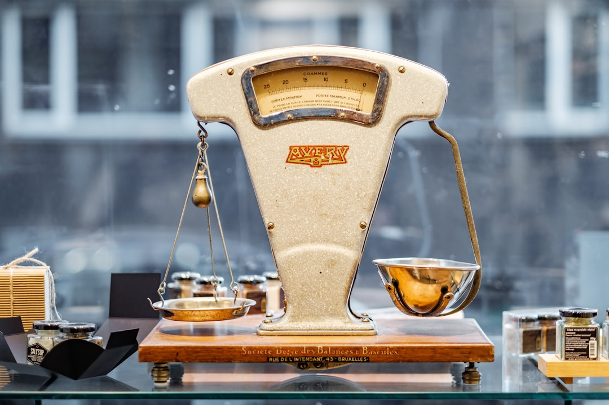

Hãy tưởng tượng bạn dự định mua một căn nhà trị giá 3 tỷ đồng. Bạn có thể tự bỏ toàn bộ 3 tỷ đồng tiền tiết kiệm sẵn có.

Bạn cũng có thể chỉ bỏ ra 1 tỷ và vay ngân hàng 2 tỷ đồng còn lại. Tỷ lệ phân chia giữa tiền túi và tiền vay đó chính là cơ cấu vốn.

Doanh nghiệp trên thị trường chứng khoán cũng vận hành theo nguyên lý tương tự. Cách doanh nghiệp tìm kiếm nguồn tài trợ quyết định sự an toàn và tỷ suất sinh lời của cổ đông.

Chọn sai cơ cấu vốn, một đợt tăng lãi suất có thể bào mòn sạch [biên lợi nhuận ròng](/phan-tich/co-ban/bien-loi-nhuan-rong/). Ngược lại, một cơ cấu vốn hợp lý sẽ trở thành bệ phóng cho công ty bứt phá.

Cùng **[Value Investing](/)** tìm hiểu cơ cấu vốn là gì. Bài viết hướng dẫn cách xác định cơ cấu vốn tối ưu và phương pháp nhận diện rủi ro đòn bẩy.

## Cơ cấu vốn là gì? Bản chất của nguồn tài trợ doanh nghiệp

Cơ cấu vốn (Capital Structure) là tỷ lệ kết hợp giữa nợ phải trả và vốn chủ sở hữu. Doanh nghiệp huy động các nguồn vốn này để tài trợ cho tài sản và hoạt động sản xuất kinh doanh.

Chỉ số này phản ánh chiến lược tài chính của ban lãnh đạo. Trong phương pháp [phân tích cơ bản là gì](/phan-tich/co-ban/phan-tich-co-ban-la-gi/), việc mổ xẻ cơ cấu vốn cho biết công ty đang phát triển bằng nội lực vốn cổ đông hay đang phụ thuộc quá nhiều vào nguồn vốn vay rủi ro.

Khi mở rộng quy mô, doanh nghiệp luôn cần lượng vốn lớn. Nguồn tiền này dùng để xây dựng nhà xưởng và mua sắm máy móc.

Để đáp ứng nhu cầu này, doanh nghiệp có hai con đường huy động vốn chính.

Con đường thứ nhất là huy động vốn chủ sở hữu. Công ty phát hành cổ phiếu cho các cổ đông hoặc giữ lại lợi nhuận làm ra qua các năm để tái đầu tư.

Con đường thứ hai là sử dụng vốn vay nợ. Công ty đi vay ngân hàng thương mại hoặc phát hành trái phiếu doanh nghiệp ra công chúng.

Công ty có cơ cấu 30% nợ và 70% vốn chủ sẽ có tính tự chủ cao. Họ ít chịu áp lực từ các chủ nợ.

Ngược lại, công ty có 80% nợ và 20% vốn chủ đang gánh đòn bẩy khổng lồ. Rủi ro vỡ nợ của họ rất cao.

Mọi biến động nhỏ về doanh thu đều có thể khiến doanh nghiệp này rơi vào cảnh mất khả năng thanh toán. Cơ cấu vốn đóng vai trò như nền móng chịu lực của một tòa nhà cao tầng.

Hiểu rõ cơ cấu vốn là bước đầu tiên để bảo vệ danh mục đầu tư. Nó giúp bạn tránh xa những doanh nghiệp đang ngập chìm trong nợ nần.

## Các thành phần cốt lõi của cơ cấu vốn trên bảng cân đối kế toán

Để đọc vị cơ cấu vốn, bạn chỉ cần mở phần Nguồn vốn trên [bảng cân đối kế toán](/phan-tich/co-ban/bang-can-doi-ke-toan-nguon-von/). Toàn bộ nguồn vốn được chia thành hai cấu phần rạch ròi.

*Ảnh: Piret Ilver / Unsplash*

Cấu phần thứ nhất là Nợ phải trả (Mã số 300). Đây là toàn bộ nghĩa vụ tài chính mà doanh nghiệp phải có trách nhiệm hoàn trả cho các chủ nợ trong tương lai.

Nợ phải trả gồm nợ ngắn hạn và nợ dài hạn. Tuy nhiên, nhà đầu tư thông minh cần bóc tách nợ phải trả thành hai nhóm có bản chất khác nhau.

Nhóm thứ nhất là nợ vay chịu lãi suất. Đây là các khoản vay ngân hàng và trái phiếu phát hành. Khoản nợ này bắt buộc phải trả lãi định kỳ dù công ty làm ăn có lãi hay lỗ.

Nhóm thứ hai là nợ chiếm dụng vốn không chịu lãi. Đây là tiền nợ nhà cung cấp chưa thanh toán hoặc tiền người mua trả trước. Doanh nghiệp được sử dụng nguồn vốn này miễn phí mà không phải trả bất kỳ đồng lãi nào.

Cấu phần thứ hai là Vốn chủ sở hữu (Mã số 400). Đây là phần tài sản thuần thực sự thuộc quyền sở hữu của các cổ đông.

Vốn chủ sở hữu gồm vốn góp cổ đông, thặng dư vốn và các quỹ dự phòng. Đây là nguồn lực tự có của công ty. Quan trọng nhất trong cấu phần này là khoản lợi nhuận sau thuế chưa phân phối tích lũy qua nhiều năm.

Hãy cùng quan sát ví dụ cụ thể về cơ cấu nguồn vốn của Công ty Cổ phần Thép Việt Thành:

| Khoản mục nguồn vốn | Mã số | Số tiền (Tỷ đồng) | Tỷ trọng cơ cấu |
| :--- | :--- | :--- | :--- |
| Nợ vay ngắn hạn ngân hàng | 320 | 1.500 | 15,0% |
| Phải trả người bán ngắn hạn | 311 | 1.000 | 10,0% |
| Nợ vay dài hạn ngân hàng | 338 | 1.500 | 15,0% |
| Tổng nợ phải trả | 300 | 4.000 | 40,0% |
| Vốn góp của chủ sở hữu | 411 | 4.000 | 40,0% |
| Lợi nhuận sau thuế chưa phân phối | 421 | 2.000 | 20,0% |
| Tổng vốn chủ sở hữu | 400 | 6.000 | 60,0% |
| Tổng cộng nguồn vốn | 440 | 10.000 | 100,0% |

Qua bảng số liệu trên, Thép Việt Thành có cơ cấu vốn gồm 40% nợ và 60% vốn chủ sở hữu. Trong 4.000 tỷ đồng nợ, chỉ có 3.000 tỷ đồng là nợ vay chịu lãi suất.

Khoản 1.000 tỷ đồng còn lại là vốn chiếm dụng lành mạnh từ người bán. Đây là một cơ cấu vốn cân bằng và an toàn cho doanh nghiệp sản xuất.

## Thế nào là cơ cấu vốn tối ưu? Bài toán cân bằng giữa chi phí và rủi ro

Cơ cấu vốn tối ưu (Optimal Capital Structure) là tỷ lệ pha trộn hoàn hảo giữa nợ và vốn cổ phần. Tỷ lệ này giúp tối thiểu hóa chi phí sử dụng vốn bình quân và tối đa hóa giá trị thị trường của doanh nghiệp.

*Ảnh: Abbe Sublett / Unsplash*

Nhiều người thường đặt câu hỏi: Tại sao doanh nghiệp không dùng 100% vốn cổ đông để tránh hoàn toàn rủi ro nợ nần?

Câu trả lời nằm ở chi phí sử dụng vốn. Vay nợ ngân hàng thường có chi phí rẻ hơn nhiều so với việc phát hành thêm cổ phiếu cho cổ đông.

Khi đi vay, lãi vay được tính vào chi phí tài chính trước khi tính thuế thu nhập doanh nghiệp. Điều này tạo ra một lợi ích rất lớn gọi là lá chắn thuế từ lãi vay (Tax Shield).

Khoản tiết kiệm thuế này giúp hạ thấp chi phí vốn thực tế của doanh nghiệp. Ngoài ra, việc dùng vốn vay giúp tránh làm pha loãng quyền biểu quyết và tỷ lệ sở hữu của các cổ đông sáng lập.

Tuy nhiên, việc vay nợ giống như một con dao hai lưỡi sắc bén. Khi doanh nghiệp vay nợ quá nhiều, rủi ro tài chính sẽ gia tăng nhanh chóng.

Các ngân hàng sẽ đòi hỏi mức lãi suất cao hơn để bù đắp rủi ro vỡ nợ. Giá cổ phiếu trên thị trường cũng có xu hướng giảm vì nhà đầu tư lo sợ nguy cơ kiệt quệ tài chính.

Cơ cấu vốn chỉ tối ưu khi tỷ suất sinh lời [chỉ số ROIC](/phan-tich/co-ban/roic-la-gi/) cao hơn lãi suất ngân hàng. Đây là điều kiện tiên quyết.

Giả sử công ty vay với lãi suất 8% nhưng tạo ra ROIC 18%. Phần chênh lệch 10% sẽ chảy thẳng vào túi cổ đông. Đó chính là sức mạnh kỳ diệu của đòn bẩy tài chính thông minh.

Trong tài chính doanh nghiệp, điểm tối ưu này được xác định qua chi phí vốn bình quân WACC.

Khi công ty bắt đầu bổ sung nợ vay, chi phí vốn WACC sẽ giảm dần nhờ lá chắn thuế. Giá trị của doanh nghiệp trên thị trường nhờ đó được nâng lên đáng kể.

Tuy nhiên, nếu vay nợ vượt quá ngưỡng chịu đựng, rủi ro vỡ nợ sẽ tăng vọt. Chi phí kiệt quệ tài chính sẽ triệt tiêu toàn bộ lợi ích của việc tiết kiệm thuế.

Đường cong WACC sẽ tạo thành hình chữ U kinh điển. Điểm đáy của chữ U chính là tỷ lệ cơ cấu vốn tối ưu nhất.

Tại điểm đó, chi phí sử dụng vốn của doanh nghiệp đạt mức thấp nhất có thể. Giá trị tài sản của mọi cổ đông sẽ được tối đa hóa trên thị trường chứng khoán.

## Các chỉ số đo lường cơ cấu vốn và chuẩn mực so sánh theo ngành

Để đánh giá mức độ lành mạnh của cơ cấu vốn, nhà đầu tư cần sử dụng ba chỉ số then chốt sau đây:

Chỉ số thứ nhất là Tỷ lệ Nợ trên Vốn chủ sở hữu (Debt to Equity Ratio - D/E). Công thức tính toán được xác định như sau:

**Tỷ lệ D/E = Tổng nợ phải trả / Vốn chủ sở hữu**

Tỷ lệ D/E cho biết với mỗi 1 đồng vốn cổ đông tự bỏ ra, doanh nghiệp đang gánh thêm bao nhiêu đồng nợ. Tỷ lệ D/E càng cao thì mức độ đòn bẩy tài chính càng lớn.

Chỉ số thứ hai là Tỷ lệ Nợ vay trên Tổng tài sản (Debt to Assets). Chỉ số này đo lường phần trăm tài sản của công ty được tài trợ bởi nợ vay ngân hàng:

**Tỷ lệ Nợ vay / Tổng tài sản = Tổng nợ vay chịu lãi / Tổng tài sản**

Chỉ số thứ ba là Hệ số đòn bẩy tài chính (Financial Leverage). Đây là nhân tố quan trọng cấu thành nên chỉ số ROE:

**Đòn bẩy tài chính = Tổng tài sản / Vốn chủ sở hữu**

Mỗi ngành nghề kinh doanh có một mức cơ cấu vốn tối ưu hoàn toàn khác nhau. Dưới đây là bảng tham chiếu tỷ lệ D/E tại các ngành lớn trên sàn chứng khoán Việt Nam:

| Nhóm ngành | Cổ phiếu tiêu biểu | Tỷ lệ D/E phổ biến | Đánh giá mức độ an toàn |
| :--- | :--- | :--- | :--- |
| Công nghệ thông tin | FPT, CMG | 0,2 – 0,5 | Cực kỳ an toàn, tiền mặt ròng dồi dào, hầu như không phụ thuộc nợ |
| Hàng tiêu dùng, Dược | VNM, DHG | 0,3 – 0,6 | Rất an toàn, dòng tiền ổn định, tự tài trợ bằng lợi nhuận giữ lại |
| Sản xuất công nghiệp | HPG, HSG | 0,6 – 1,2 | Cân bằng, sử dụng nợ vay dài hạn để đầu tư nhà máy và máy móc |
| Tiện ích điện, nước | REE, POW | 1,0 – 1,8 | Chấp nhận được nhờ dòng tiền bán điện đều đặn hàng tháng |
| Bất động sản xây dựng | NVL, DXG | 1,2 – 2,5 | Rủi ro cao, rất nhạy cảm với biến động lãi suất và thanh khoản |

Bạn nên kết hợp tỷ lệ D/E cùng [hệ số thanh toán](/phan-tich/co-ban/he-so-thanh-toan-la-gi/) để có được bức tranh chuẩn xác nhất về an toàn vốn.

## 4 sai lầm nguy hiểm khi phân tích cơ cấu vốn của doanh nghiệp niêm yết

Phân tích cơ cấu vốn đòi hỏi sự tỉnh táo và bóc tách kỹ lưỡng. Dưới đây là 4 sai lầm phổ biến khiến nhiều nhà đầu tư cá nhân gặp thua lỗ nặng nề:

Thứ nhất là đánh đồng toàn bộ nợ phải trả là nợ vay nguy hiểm.

Nhiều nhà đầu tư thấy nợ phải trả lớn liền vội vàng bỏ qua cổ phiếu. Thực chất, nhiều công ty bán lẻ có nợ rất cao nhưng đó là tiền chiếm dụng từ nhà cung cấp. Nguồn vốn này hoàn toàn miễn phí và không mang lại bất kỳ áp lực trả lãi vay nào.

Thứ hai là bỏ qua sự lệch pha về kỳ hạn giữa tài sản và nguồn vốn.

Sai lầm chết người của ban lãnh đạo là dùng nợ vay ngắn hạn để tài trợ cho các dự án đầu tư dài hạn. Khi ngân hàng siết tín dụng và không cho đảo nợ, doanh nghiệp sẽ lập tức mất khả năng thanh toán.

Thứ ba là ảo tưởng doanh nghiệp hoàn toàn không vay nợ là doanh nghiệp hoàn hảo.

Một công ty nắm giữ hàng nghìn tỷ đồng tiền mặt mà không vay nợ có thể đang đánh mất cơ hội tăng trưởng. Ban lãnh đạo quá bảo thủ sẽ không tạo ra được giá trị thặng dư tối đa cho cổ đông.

Thứ tư là cạm bẫy che giấu nợ ngoài bảng cân đối kế toán.

Doanh nghiệp có thể phát hành trái phiếu thông qua công ty con hoặc cam kết bảo lãnh các khoản vay phức tạp. Nếu chỉ nhìn vào báo cáo công ty mẹ, bạn sẽ hoàn toàn bỏ lỡ khối nợ tiềm ẩn khổng lồ này.

Cơ cấu vốn chính là khung xương chịu lực quyết định sự trường tồn của mọi doanh nghiệp. Hãy phân tích tỷ lệ nợ kết hợp cùng [hệ số thanh toán](/phan-tich/co-ban/he-so-thanh-toan-la-gi/). Bạn sẽ nắm vững [cách chọn cổ phiếu tốt](/dau-tu/co-phieu/cach-chon-co-phieu-tot/) và đầu tư an toàn.
