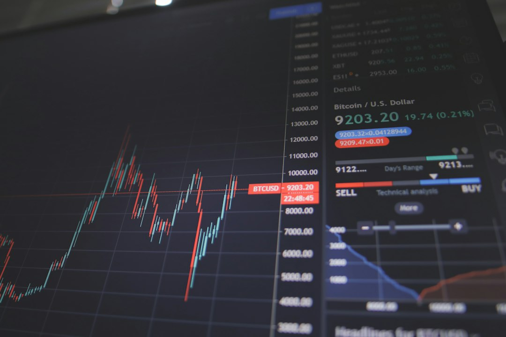

Nhiều người tin rằng Fibonacci thoái lui hoạt động nhờ một quy luật tự nhiên ẩn trong giá cổ phiếu. Sự thật là chưa có nghiên cứu nào chứng minh điều đó. Các mức này có tác dụng chủ yếu vì rất nhiều nhà giao dịch cùng nhìn vào chúng.

Bài này của **[Value Investing](/)** giải thích Fibonacci thoái lui là gì, cách vẽ đúng hướng và cách đọc từng mức. Ví dụ dùng giá cụ thể bằng đồng, kèm cách tính tỷ lệ lời/lỗ.

Phần cuối nói thẳng về hạn chế của công cụ này. Bạn cũng sẽ thấy cách áp dụng khi có biên độ 7% và chu kỳ T+2 ở thị trường Việt Nam.

## Fibonacci thoái lui là gì?

Fibonacci thoái lui (Fibonacci retracement) là công cụ vẽ các đường ngang theo tỷ lệ phần trăm của một đợt tăng hoặc giảm giá. Các đường này đánh dấu nơi giá có thể dừng lại khi điều chỉnh, trước khi đi tiếp theo xu hướng chính.

Trong xu hướng tăng, các mức Fibonacci đóng vai trò vùng hỗ trợ tiềm năng. Trong xu hướng giảm, chúng trở thành vùng kháng cự tiềm năng.

Hãy thử nghĩ thế này. Giá xăng tăng từ 20.000 lên 25.000 đồng một lít trong vài tháng. Sau đó giá giảm nhẹ về 23.500 đồng rồi lại tăng tiếp.

Mức giảm 1.500 đồng chính là một nhịp thoái lui, bằng 30% đợt tăng 5.000 đồng. Fibonacci thoái lui giúp bạn đo trước nhịp giảm đó có thể dừng ở 23,6%, 38,2% hay 61,8%.

Khác với ngưỡng ngang trong bài [hỗ trợ kháng cự là gì](/phan-tich/ky-thuat/ho-tro-khang-cu-la-gi/), mức Fibonacci không cần giá từng chạm vào trước đó. Nó được tính hoàn toàn từ một đỉnh và một đáy.

Vì vậy, công cụ này hữu ích nhất khi giá vừa lập đỉnh mới và chưa có vùng giá cũ nào để tham chiếu. Nó cũng là một phần của [phân tích kỹ thuật](/phan-tich/ky-thuat/phan-tich-ky-thuat-la-gi/) nên chỉ dựa trên giá quá khứ, không nói gì về sức khỏe doanh nghiệp.

## Các mức Fibonacci và nguồn gốc của chúng

Dãy Fibonacci được nhà toán học Leonardo xứ Pisa đưa vào châu Âu qua cuốn Liber Abaci năm 1202. Mỗi số trong dãy bằng tổng hai số đứng trước nó.

- **Dãy số**. 0, 1, 1, 2, 3, 5, 8, 13, 21, 34, 55, 89, 144...

- **Tỷ lệ 61,8%**. Chia mỗi số cho số liền sau, ví dụ 34/55 = 0,618. Đây là tỷ lệ vàng mà nhiều tài liệu nhắc tới.

- **Tỷ lệ 38,2%**. Chia mỗi số cho số đứng sau hai vị trí, ví dụ 34/89 = 0,382.

- **Tỷ lệ 23,6%**. Chia mỗi số cho số đứng sau ba vị trí, ví dụ 34/144 = 0,236.

Bài của VnExpress và Finhay viết rằng 0,236 là phép chia cho số đứng sau hai vị trí. Ví dụ đi kèm của họ lại là ba vị trí, nên bạn cần lưu ý chỗ này.

Bảng dưới tóm tắt 5 mức mà phần mềm biểu đồ thường hiển thị mặc định.

| Mức | Nguồn gốc | Cách đọc phổ biến |
|---|---|---|
| 23,6% | Tỷ lệ Fibonacci (cách 3 vị trí) | Điều chỉnh nông, xu hướng còn rất mạnh |
| 38,2% | Tỷ lệ Fibonacci (cách 2 vị trí) | Điều chỉnh vừa, vùng chờ mua đầu tiên |
| 50% | Lý thuyết Dow, không phải tỷ lệ Fibonacci | Giá hồi một nửa đợt tăng |
| 61,8% | Tỷ lệ vàng | Vùng phòng thủ cuối của xu hướng |
| 78,6% | Căn bậc hai của 0,618 | Điều chỉnh sâu, xu hướng có thể đã gãy |

Mức 50% là điểm dễ hiểu nhầm nhất. Theo StockCharts, nó đến từ quan sát của Lý thuyết Dow rằng giá thường hồi khoảng một nửa đợt tăng trước đó. Nó được đưa vào bộ công cụ vì nhiều người theo dõi, không vì toán học.

## Cách vẽ Fibonacci thoái lui qua 4 bước

Vẽ sai điểm đầu và điểm cuối thì mọi mức phía sau đều sai. Quy trình dưới đây áp dụng cho xu hướng tăng trên biểu đồ ngày.

1. **Xác định xu hướng chính**. Chỉ vẽ khi giá đã tạo một đợt tăng hoặc giảm dễ nhận ra. Thị trường đi ngang thì Fibonacci gần như không có ý nghĩa.

2. **Chọn đáy bắt đầu đợt tăng**. Đây là giá thấp nhất ngay trước khi đợt tăng diễn ra. Dùng giá thấp nhất của cây nến, không dùng giá đóng cửa.

3. **Chọn đỉnh cao nhất của đợt tăng**. Đây là giá cao nhất trước khi nhịp điều chỉnh bắt đầu. Đỉnh này phải được xác nhận bằng ít nhất 2–3 phiên giảm sau đó.

4. **Kéo công cụ từ đáy lên đỉnh**. Trên TradingView hay app của công ty chứng khoán, chọn công cụ Fib thoái lui rồi kéo từ điểm bước 2 tới điểm bước 3. Xu hướng giảm thì làm ngược lại, kéo từ đỉnh xuống đáy.

*Ảnh: Nick Chong / Unsplash*

### Ví dụ tính các mức với cổ phiếu G

Ví dụ giả định: cổ phiếu G tăng từ đáy 20.000 đồng lên đỉnh 30.000 đồng trong 3 tháng. Biên độ đợt tăng là 10.000 đồng.

Mỗi mức thoái lui được tính bằng **Giá mức = Đỉnh − (Đỉnh − Đáy) × Tỷ lệ**. Kết quả cụ thể như sau.

| Mức | Phép tính | Giá |
|---|---|---|
| 23,6% | 30.000 − 10.000 × 0,236 | 27.640 đồng |
| 38,2% | 30.000 − 10.000 × 0,382 | 26.180 đồng |
| 50% | 30.000 − 10.000 × 0,5 | 25.000 đồng |
| 61,8% | 30.000 − 10.000 × 0,618 | 23.820 đồng |
| 78,6% | 30.000 − 10.000 × 0,786 | 22.140 đồng |

Phần mềm sẽ tự tính các con số này. Bạn vẫn nên tự kiểm tra một lần để chắc rằng mình đã kéo đúng đáy và đỉnh.

Để ý khoảng cách giữa hai mức liền kề của cổ phiếu G chỉ khoảng 1.200–1.500 đồng. Một phiên biến động 5% cũng đủ đưa giá đi qua hai mức cùng lúc. Vì vậy, bạn nên coi mỗi mức là một vùng rộng vài trăm đồng thay vì một con số chính xác.

## Cách giao dịch với vùng Fibonacci

Mức Fibonacci là vùng chờ, không phải lệnh mua tự động. StockCharts nhấn mạnh rằng các mức thoái lui không phải điểm đảo chiều cứng. Bạn cần thêm tín hiệu xác nhận trước khi đặt lệnh.

Với cổ phiếu G, giả sử giá điều chỉnh về 26.200 đồng, sát mức 38,2%. Phiên đó tạo nến rút chân dài, phiên sau đóng cửa tăng ở 26.500 đồng.

- **Điểm mua**. 26.500 đồng, sau phiên xác nhận thay vì đặt lệnh chờ đúng 26.180 đồng.

- **Cắt lỗ**. 24.700 đồng, ngay dưới mức 50%. Nếu giá đóng cửa thủng mức 50%, nhịp điều chỉnh đã sâu hơn dự tính.

- **Mục tiêu 1**. Đỉnh cũ 30.000 đồng, lời 3.500 đồng so với rủi ro 1.800 đồng.

Tỷ lệ lời/lỗ ở mục tiêu 1 là **3.500 / 1.800 ≈ 1,9 lần**. Nếu tỷ lệ dưới 1,5 lần, bạn có thể bỏ qua tín hiệu và chờ giá về mức sâu hơn.

Nếu giá không dừng ở 38,2% mà về thẳng 61,8%, kịch bản thay đổi. Mua ở 24.000 đồng với cắt lỗ 22.000 đồng, dưới mức 78,6%, cho tỷ lệ **6.000 / 2.000 = 3 lần**. Mức càng sâu thì phần thưởng càng lớn, nhưng xác suất xu hướng còn nguyên cũng thấp hơn.

### Fibonacci mở rộng để đặt mục tiêu

Khi giá vượt đỉnh cũ, nhà giao dịch thường dùng Fibonacci mở rộng để ước lượng mục tiêu tiếp theo. Hai mức phổ biến là 127,2% và 161,8% của đợt tăng ban đầu. Người đếm [sóng Elliott](/phan-tich/ky-thuat/song-elliott-la-gi/) cũng dùng mức 161,8% để ước lượng độ dài sóng 3.

Với cổ phiếu G, mức 127,2% là **20.000 + 10.000 × 1,272 = 32.720 đồng**. Mức 161,8% là 36.180 đồng. Đây là vùng tham khảo để chốt lời từng phần, không phải giá chắc chắn sẽ tới.

Một cách làm phổ biến là bán một phần ba vị thế ở đỉnh cũ 30.000 đồng. Phần tiếp theo bán ở 32.720 đồng, phần cuối giữ lại và nâng cắt lỗ theo đáy gần nhất. Cách chia này giúp bạn khóa lợi nhuận mà vẫn còn cổ phiếu nếu xu hướng kéo dài.

## Kết hợp Fibonacci với công cụ khác

Một mức Fibonacci đứng riêng lẻ có độ tin cậy thấp. Tín hiệu mạnh hơn khi nhiều công cụ cùng chỉ về một vùng giá, gọi là vùng hợp lưu.

- **Hỗ trợ cũ**. Mức 38,2% của cổ phiếu G ở 26.180 đồng trùng với đỉnh tích lũy cũ 26.000 đồng thì đáng chú ý hơn.

- **Đường trung bình động**. Giá điều chỉnh về mức 50% đúng lúc chạm [đường EMA](/phan-tich/ky-thuat/duong-ema/) 50 ngày tạo thêm một lớp hỗ trợ.

- **Chỉ báo động lượng**. [RSI](/phan-tich/ky-thuat/rsi-la-gi/) hồi lên từ vùng dưới 40 khi giá ở mức Fibonacci cho thấy lực bán đang yếu đi.

- **Khối lượng**. Khối lượng giảm dần trong nhịp điều chỉnh là dấu hiệu người bán không mạnh. Khối lượng tăng ở phiên xác nhận củng cố thêm tín hiệu.

Value Investing gợi ý một bộ lọc đơn giản là cần ít nhất 2 yếu tố trùng nhau. Mức Fibonacci đi kèm thêm một yếu tố ở trên thì mới đưa vào danh sách theo dõi.

Ngược lại, nếu giá về mức 61,8% nhưng RSI vẫn đi xuống và khối lượng bán tăng vọt, hãy đứng ngoài. Vùng hợp lưu chỉ có giá trị khi các công cụ cùng kể một câu chuyện.

## Hạn chế và lỗi thường gặp khi dùng Fibonacci

Wikipedia tổng hợp rằng ý nghĩa đặc biệt của các mức Fibonacci chưa được xác nhận khi kiểm tra dữ liệu. Arthur Merrill trong cuốn Filtered Waves cũng kết luận không có một mức thoái lui chuẩn đáng tin cậy.

Điều này có nghĩa là gì với bạn trong thực tế? Fibonacci là công cụ đánh dấu vùng cần quan sát, không phải công cụ dự đoán. Năm lỗi dưới đây khiến người mới dùng sai công cụ này.

1. **Vẽ lại sau khi giá đã chạy**. Đổi đáy hoặc đỉnh cho tới khi một mức khớp với giá là tự biện minh. Hãy chụp màn hình bản vẽ trước khi giá chạm vùng.

2. **Chọn đỉnh đáy quá nhỏ**. Một nhịp tăng 3 phiên trên biểu đồ ngày cho các mức sát nhau, giá đi qua mọi mức chỉ trong một phiên.

3. **Mua ngay khi giá chạm mức**. Giá có thể xuyên qua 38,2% và 50% để về 61,8%. Chờ phiên xác nhận giúp bạn tránh bắt dao rơi.

4. **Bỏ qua biên độ 7%**. Mua 26.500 đồng trên HOSE, một phiên giảm sàn kéo giá về 24.645 đồng, đã dưới mức cắt lỗ 24.700 đồng. Mức cắt lỗ quá sát có thể bị phá chỉ trong một phiên.

5. **Quên chu kỳ T+2**. Cổ phiếu mua phiên T chỉ về tài khoản chiều ngày T+2. Nếu mức Fibonacci bị phá trong hai phiên này, bạn chưa bán được.

Khi giá đóng cửa thủng mức 78,6%, đợt tăng ban đầu nhiều khả năng đã kết thúc. Lúc này bạn nên thực hiện [cắt lỗ](/dau-tu/co-phieu/cat-lo-la-gi/) thay vì vẽ lại Fibonacci từ một đáy mới.

## Bước tiếp theo bạn có thể làm ngay

Insight cốt lõi là: Fibonacci thoái lui chỉ ra nơi cần chú ý. Tín hiệu xác nhận mới cho bạn biết khi nào hành động.

Bước tiếp theo bạn có thể làm ngay: mở biểu đồ ngày của một cổ phiếu vừa tăng mạnh rồi điều chỉnh. Kéo Fibonacci từ đáy lên đỉnh, ghi sẵn điểm mua, mức cắt lỗ và tỷ lệ lời/lỗ.

Khi giá vượt lại đỉnh cũ, đó chính là một cú [breakout](/phan-tich/ky-thuat/breakout-trong-chung-khoan-la-gi/) cần xác nhận. Bạn sẽ kết hợp Fibonacci với công cụ nào trước tiên?

---
*Bài viết mang tính giáo dục, không phải khuyến nghị mua hoặc bán bất kỳ cổ phiếu nào. Cổ phiếu G là ví dụ giả định. Các mức Fibonacci chỉ phản ánh xác suất, bạn tự chịu trách nhiệm với quyết định đầu tư của mình.*
