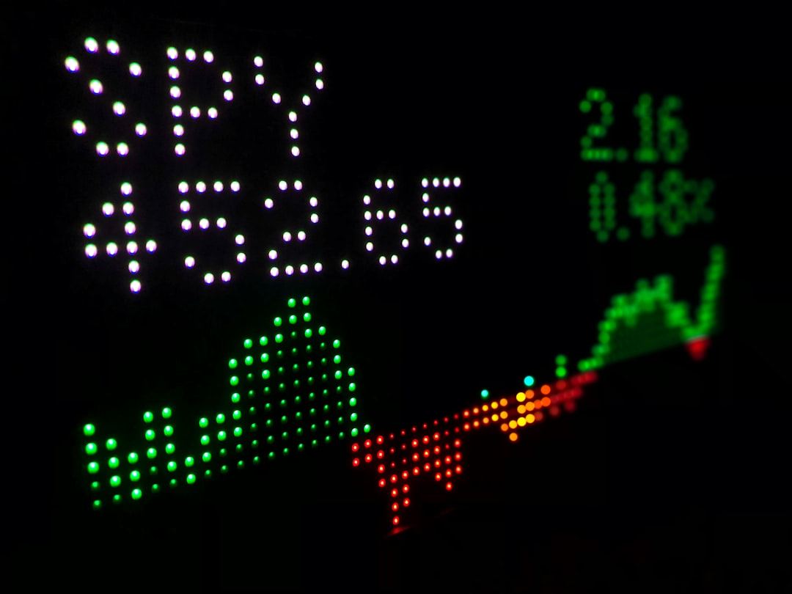

Lần đầu mở bảng điện tử, nhiều người mới bối rối trước ma trận sắc màu tím, xanh, vàng và đỏ. Thấy một mã cổ phiếu tăng kịch trần hay giảm sàn, bạn tự hỏi điều gì quyết định giới hạn đó.

Bài viết từ **[Value Investing](/)** giải thích **giá trần giá sàn là gì** và cách tính biên độ. Bạn sẽ tự tin đọc bảng điện tử.

## Khái niệm giá trần, giá sàn và giá tham chiếu

Hãy hình dung một căn phòng ngủ thông thường. Trần nhà là điểm cao nhất bạn có thể chạm tới, còn sàn nhà là mặt phẳng thấp nhất nâng đỡ bước chân.

Biên độ giá trên thị trường chứng khoán vận hành tương tự như vậy. Đối với người mới tìm hiểu [cổ phiếu là gì](/dau-tu/co-phieu/co-phieu-la-gi/), ba khái niệm giá sau đây là kiến thức nền tảng bắt buộc phải nắm vững:

* **Giá trần (Ceiling price)**. Mức giá tối đa người mua có thể đặt lệnh mua hoặc người bán có thể bán trong phiên giao dịch. Trên bảng điện tử, giá trần luôn được hiển thị bằng màu tím.

* **Giá sàn (Floor price)**. Mức giá tối thiểu được phép giao dịch trong ngày. Khi lực bán áp đảo khiến giá chạm đáy biên độ, bảng điện sẽ chuyển sang màu xanh lơ (xanh da trời).

* **Giá tham chiếu (Reference price)**. Mức giá cơ sở dùng để tính toán giá trần và giá sàn của ngày hôm đó. Trên sàn HOSE và HNX, giá tham chiếu là giá đóng cửa phiên trước. Mức giá này hiển thị bằng màu vàng.

Mọi giao dịch mua bán hợp lệ chỉ được dao động trong hành lang từ giá sàn đến giá trần. Bất kỳ lệnh đặt mua cao hơn giá trần hoặc thấp hơn giá sàn đều bị hệ thống từ chối ngay lập tức. Bạn có thể tìm hiểu thêm về [thị giá cổ phiếu](/dau-tu/co-phieu/thi-gia-co-phieu-la-gi/) để hiểu rõ bản chất hình thành mức giá khớp lệnh mỗi ngày.

## Biên độ dao động trên các sàn chứng khoán Việt Nam

Thị trường chứng khoán Việt Nam có 3 sàn giao dịch với biên độ khác nhau. Bảng dưới đây thể hiện quy định chi tiết.

| Sàn giao dịch | Biên độ dao động ngày thường | Biên độ ngày giao dịch đầu tiên | Màu sắc giá trần | Màu sắc giá sàn |
| :--- | :--- | :--- | :--- | :--- |
| **Sàn HOSE** | +/- 7% | +/- 20% | Màu tím | Màu xanh lơ |
| **Sàn HNX** | +/- 10% | +/- 30% | Màu tím | Màu xanh lơ |
| **Sàn UPCoM** | +/- 15% | +/- 40% | Màu tím | Màu xanh lơ |

Sàn HOSE quy tụ doanh nghiệp lớn nên biên độ hẹp nhất (+/-7%). Ngược lại, sàn UPCoM có biên độ rộng (+/-15%), khiến mức biến động tài sản mỗi ngày cao hơn.

*Ảnh: Tyler Prahm / Unsplash*

## Cách tính giá trần và giá sàn kèm quy tắc làm tròn

Công thức tính giá trần và giá sàn dựa vào giá tham chiếu của phiên.

* **Công thức giá trần**. `Giá trần = Giá tham chiếu * (1 + Biên độ dao động)`.

* **Công thức giá sàn**. `Giá sàn = Giá tham chiếu * (1 - Biên độ dao động)`.

Kết quả tính toán bắt buộc phải tuân theo quy tắc làm tròn bước giá. Quy tắc này do Sở Giao dịch ban hành.

### Ví dụ tính giá trần sàn trên sàn HOSE

Một cổ phiếu trên HOSE có giá đóng cửa hôm qua là 35.500 đồng. Bước giá quy định cho vùng giá này là 50 đồng.

* **Tính giá trần**. `35.500 * (1 + 0,07) = 37.985 đồng`. Theo bước giá 50 đồng, giá trần làm tròn xuống mức 37.950 đồng.

* **Tính giá sàn**. `35.500 * (1 - 0,07) = 33.015 đồng`. Làm tròn lên bước giá 50 đồng, giá sàn là 33.050 đồng.

Nhờ quy tắc này, cổ phiếu chỉ khớp lệnh từ 33.050 đồng đến 37.950 đồng. Lệnh nằm ngoài dải giá sẽ bị từ chối.

## Trắng bên mua và trắng bên bán là gì?

Khi quan sát bảng điện, bạn sẽ bắt gặp hai trạng thái cung cầu cực đoan.

* **Trắng bên mua (Dư bán sàn)**. Lực bán tháo bằng mọi giá quá lớn, không ai chịu mua. Cổ phiếu bị khóa ở giá sàn và cột bên mua trống trơn.

* **Trắng bên bán (Dư mua trần)**. Dòng tiền đổ xô tranh mua giá trần. Không ai muốn bán ra, khiến cột dư bán hoàn toàn trống rỗng.

Khi gặp trạng thái này, việc dùng [các loại lệnh trong chứng khoán](/dau-tu/co-phieu/cac-loai-lenh-trong-chung-khoan/) như MP hay ATO/ATC cần hết sức cẩn trọng.

## Lời khuyên kiểm soát tâm lý khi cổ phiếu chạm trần hoặc sàn

Màu tím kích thích lòng tham, còn màu xanh lơ gây hoảng sợ. Người mới dễ mắc bẫy mua giá tím khi cổ phiếu tăng nóng, hoặc bán tháo đúng đáy.

Bạn hãy ghi nhớ 3 nguyên tắc thực tế sau.

* **Không mua đuổi giá tím**. Mua khi dư mua trần hàng triệu cổ phiếu khiến bạn gánh rủi ro điều chỉnh rất lớn.

* **Tìm hiểu nguyên nhân khi giảm sàn**. Doanh nghiệp giảm sàn do tin đồn vô căn cứ có thể mở ra cơ hội tích lũy giá rẻ.

* **Lập kế hoạch từ trước phiên**. Hãy xác định ngưỡng chốt lời và phòng thủ cụ thể. Đừng quyết định cảm tính theo màu sắc bảng điện.

Hiểu rõ cơ chế giá trần giá sàn giúp bạn làm chủ bảng điện và tránh tâm lý mua đỉnh bán đáy. Hãy tham khảo thêm hướng dẫn [cách đầu tư cổ phiếu](/dau-tu/co-phieu/cach-dau-tu-co-phieu/) để xây dựng kế hoạch giao dịch bài bản, kỷ luật ngay từ những bước đầu tiên.
