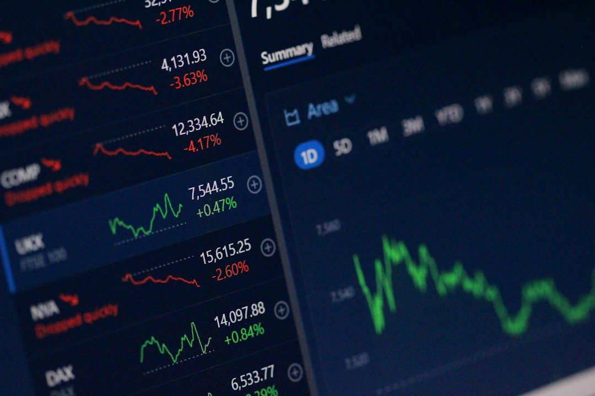

Trong trường phái [phân tích kỹ thuật là gì](/phan-tich/ky-thuat/phan-tich-ky-thuat-la-gi/), việc nắm bắt thời điểm đảo chiều là chìa khóa then chốt. Cùng **[Value Investing](/)**, khái niệm **Golden Cross là gì** luôn thu hút sự quan tâm của nhiều nhà đầu tư.

Tín hiệu này được ví như tiếng còi báo hiệu chu kỳ tăng giá dài hạn mới. Khi hiểu rõ bản chất của nó, bạn sẽ tự tin giải ngân và nâng cao hiệu quả đầu tư.

## Golden Cross là gì trong chứng khoán?

Golden Cross (điểm giao cắt vàng) là mô hình kỹ thuật báo hiệu xu hướng tăng giá. Mô hình này xuất hiện khi đường trung bình động ngắn hạn cắt lên trên đường dài hạn. Tín hiệu này cho thấy phe mua đã hoàn toàn giành lại quyền kiểm soát thị trường.

Trên biểu đồ ngày (D1), cặp [đường MA](/phan-tich/ky-thuat/duong-ma-la-gi/) chuẩn mực nhất là MA50 và [đường MA200](/phan-tich/ky-thuat/duong-ma200/). Đường MA50 phản ánh mức giá trung bình của 50 phiên giao dịch gần nhất. Trong khi đó, đường MA200 đại diện cho xu hướng dài hạn của cả năm qua.

Khi MA50 cắt lên MA200, giá vốn trung hạn đã vượt lên trên mức bình quân dài hạn. Dòng tiền mới sẵn sàng trả giá cao hơn để gom cổ phiếu. Đây là minh chứng rõ ràng cho thấy tâm lý bi quan đã hoàn toàn biến mất.

Hiện tượng này cũng thường kích hoạt dòng tiền từ các quỹ đầu tư tổ chức. Nhiều hệ thống giao dịch tự động của các quỹ lớn thiết lập lệnh mua khi điểm giao cắt vàng xuất hiện. Nhờ đó, lực mua thường gia tăng mạnh mẽ trên quy mô toàn thị trường.

Ngoài MA50 và MA200, nhà đầu tư lướt sóng còn dùng các cặp đường ngắn hơn. Bạn có thể sử dụng MA10 cắt MA20, hoặc [đường EMA](/phan-tich/ky-thuat/duong-ema/) 12 cắt EMA26. Dù vậy, tín hiệu giữa MA50 và MA200 vẫn là kim chỉ nam uy tín nhất trên chỉ số VN-Index lẫn cổ phiếu riêng lẻ.

## 3 giai đoạn hình thành điểm giao cắt vàng

Điểm giao cắt vàng không bao giờ hình thành sau một đêm. Quá trình này luôn trải qua 3 giai đoạn chuyển biến tâm lý rõ rệt.

Giai đoạn đầu tiên là cạn kiệt đà giảm và tích lũy tạo đáy. Trước đó, cổ phiếu thường trải qua đợt giảm giá sâu kéo dài. Áp lực bán tháo dần biến mất khi dòng tiền lớn âm thầm gom hàng. Thanh khoản thị trường ở giai đoạn này thường tụt dốc xuống mức rất thấp. Giá cổ phiếu ngừng rơi và tạo nền tích lũy vững chắc quanh vùng đáy. Lúc này, đường MA50 vẫn nằm sâu phía dưới đường MA200.

Giai đoạn thứ hai là sự bứt phá và tạo điểm giao cắt. Lực cầu gia tăng mạnh mẽ đẩy giá cổ phiếu vượt lên trên MA200. Đà hồi phục nhanh khiến đường MA50 dốc ngược lên và cắt qua MA200. Phiên giao cắt thường đi kèm khối lượng giao dịch tăng đột biến. Sự bùng nổ của thanh khoản chứng minh các tổ chức tài chính đã vào cuộc quyết liệt. Cột mốc Golden Cross chính thức được kích hoạt trên biểu đồ giá.

Giai đoạn thứ ba là xác lập xu hướng tăng giá bền vững. Đường MA50 sau đó duy trì vị trí vững chắc phía trên đường MA200. Cả hai đường trung bình động đều cùng dốc lên trên theo thời gian. Khi giá điều chỉnh, MA50 và MA200 sẽ đóng vai trò bệ đỡ hỗ trợ kiên cố. Nhờ đó, đường giá có thêm điểm tựa để tiếp tục chinh phục các đỉnh cao mới trong tương lai.

*Ảnh: Nick Chong / Unsplash*

## So sánh Golden Cross và Death Cross

Để áp dụng hiệu quả, bạn cần đặt điểm giao cắt vàng bên cạnh đối trọng của nó. Đó là Death Cross, hay còn gọi là điểm giao cắt tử thần.

| Tiêu chí so sánh | Golden Cross (Giao cắt vàng) | Death Cross (Giao cắt tử thần) |
|---|---|---|
| **Bản chất kỹ thuật** | MA ngắn hạn (MA50) cắt lên trên MA dài hạn (MA200) | MA ngắn hạn (MA50) cắt xuống dưới MA dài hạn (MA200) |
| **Xu hướng dự báo** | Đảo chiều từ giảm sang tăng dài hạn (Bull Market) | Đảo chiều từ tăng sang giảm dài hạn (Bear Market) |
| **Tâm lý thị trường** | Bên mua áp đảo, dòng tiền lớn gom hàng quyết liệt | Bên bán chiếm ưu thế, dòng tiền tháo chạy phòng thủ |
| **Vai trò các đường MA** | MA50 và MA200 trở thành vùng hỗ trợ động | MA50 và MA200 trở thành vùng kháng cự động |
| **Chiến lược hành động** | Mở vị thế mua mới hoặc gia tăng tỷ trọng cổ phiếu | Thu hẹp danh mục, bán hạ tỷ trọng hoặc thoát hàng |
| **Bối cảnh rủi ro** | Dễ dính bẫy tăng giá giả khi thị trường đi ngang | Dễ bán đúng đáy nếu giá chỉ giảm điểm cục bộ |

Sự luân chuyển giữa hai mô hình phản ánh chu kỳ bất biến của thị trường. Khi đợt suy thoái kết thúc, điểm giao cắt vàng mở ra chu kỳ tăng giá mới. Ngược lại, khi thị trường bước vào giai đoạn phân phối, giao cắt tử thần sẽ xuất hiện. Đây là lời cảnh báo sớm để nhà đầu tư kịp thời bảo toàn vốn.

## Chiến lược giao dịch hiệu quả với Golden Cross

Sở hữu tín hiệu giao cắt là lợi thế, nhưng cách vào lệnh mới quyết định thành công. Dưới đây là 3 chiến lược thực chiến giúp bạn tối ưu hóa điểm mua.

Chiến lược đầu tiên là mua ngay tại phiên bứt phá có khối lượng lớn. Khi MA50 vừa vắt qua MA200 kèm theo nến tăng mạnh, bạn có thể giải ngân. Thanh khoản phiên đó cần cao gấp 1,5 đến 2 lần mức trung bình 20 phiên. Dòng tiền xác nhận chứng minh tổ chức lớn đã bảo kê cho xu hướng tăng. Bạn nên giải ngân khoảng 30% đến 40% quy mô vốn dự kiến cho bước khởi đầu này.

Chiến lược thứ hai là mua khi giá kiểm định lại vùng hỗ trợ. Sau nhịp tăng mạnh, giá thường có xu hướng điều chỉnh nhẹ để rũ bỏ nhỏ lẻ. Khi giá lùi về chạm MA50 hoặc MA200 rồi bật tăng với thanh khoản thấp, hãy mở vị thế. Cách này giúp bạn mua được giá tốt và tránh bị tâm lý fomo chi phối. Đây là điểm vào lệnh ưa thích của nhiều nhà giao dịch theo xu hướng chuyên nghiệp.

Chiến lược thứ ba là kết hợp với [chỉ báo MACD](/phan-tich/ky-thuat/macd-la-gi/) và [chỉ số RSI](/phan-tich/ky-thuat/rsi-la-gi/). Sự đồng thuận của nhiều công cụ kỹ thuật sẽ giúp bạn lọc bỏ tín hiệu nhiễu. Ví dụ, MACD vừa cắt lên đường tín hiệu và RSI vượt mốc 50 điểm sẽ củng cố đà tăng. Tín hiệu Golden Cross khi đó sẽ có độ tin cậy cao hơn rất nhiều.

Dù chọn phương án nào, bạn cũng phải tuân thủ kỷ luật quản trị rủi ro. Hãy chủ động đặt lệnh [cắt lỗ](/dau-tu/co-phieu/cat-lo-la-gi/) ngay bên dưới đáy gần nhất hoặc cách MA200 từ 5% đến 7%. Đồng thời, hãy sử dụng kỹ thuật nâng điểm chặn lãi (trailing stop) khi giá cổ phiếu liên tục leo dốc. Việc bảo vệ nguồn vốn luôn là ưu tiên hàng đầu của mọi nhà đầu tư.

*Ảnh: Anne Nygård / Unsplash*

## Bẫy tăng giá và các sai lầm cần tránh khi dùng Golden Cross

Điểm giao cắt vàng là chỉ báo uy tín, nhưng nó không phải là chén thánh thần kỳ. Việc áp dụng máy móc có thể khiến tài khoản của bạn bị tổn thất nặng nề.

Hạn chế lớn nhất của mô hình này nằm ở độ trễ về mặt thời gian. Do MA50 và MA200 đều tính từ giá quá khứ, nên độ trễ là điều khó tránh khỏi. Khi hai đường cắt nhau, giá cổ phiếu có thể đã tăng từ 15% đến 25% từ đáy. Mua đuổi ở vùng này khiến bạn dễ phải hứng chịu đợt điều chỉnh ngắn hạn. Vì vậy, việc giải ngân từng phần luôn an toàn hơn việc dồn toàn bộ vốn một lần.

Sai lầm tiếp theo là dùng mô hình trong giai đoạn thị trường đi ngang. Khi giá dao động hẹp, các đường trung bình thường quấn chặt lấy nhau. Điểm giao cắt vàng xuất hiện rồi nhanh chóng bị bẻ gãy, tạo thành bẫy tăng giá. Nếu không cẩn trọng, nhà đầu tư rất dễ mua đúng đỉnh của các đợt hồi phục giả tạo.

Để giao dịch an toàn, bạn hãy tuân thủ 3 nguyên tắc thực chiến quan trọng sau.

Thứ nhất, luôn đợi khối lượng giao dịch đột biến xác nhận dòng tiền lớn nhập cuộc. Thứ hai, tuyệt đối không mua đuổi khi giá đã chạy quá xa đường MA200. Thứ ba, luôn kết hợp phân tích nội tại doanh nghiệp với cẩm nang [cách đầu tư cổ phiếu](/dau-tu/co-phieu/cach-dau-tu-co-phieu/) để chọn được những mã có nền tảng cơ bản vững vàng cùng điểm mua kỹ thuật tối ưu.
