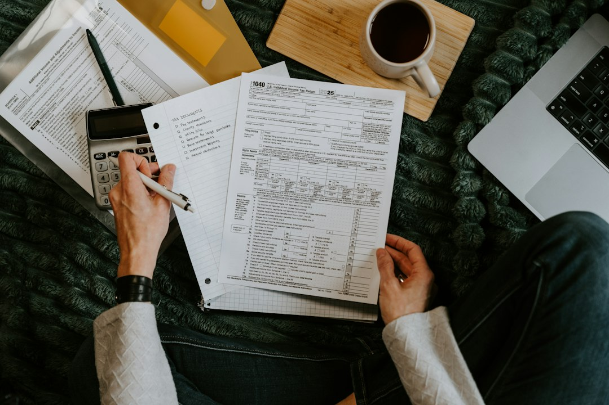

Nhiều nhà đầu tư chỉ mải mê săn tìm các cổ phiếu có lợi nhuận tăng trưởng mạnh mẽ. Họ quên mất một sự thật tàn khốc trên thương trường.

Doanh nghiệp không phá sản vì thiếu lợi nhuận trên sổ sách kế toán. Họ phá sản vì cạn kiệt khả năng thanh toán các khoản nợ đến hạn.

Một khoản nợ ngắn hạn vài chục tỷ không trả được có thể đánh sập cả đế chế nghìn tỷ chỉ sau một đêm. Hệ số thanh toán chính là chiếc phanh an toàn bảo vệ dòng tiền.

Cùng **[Value Investing](/)** tìm hiểu hệ số thanh toán là gì. Bài viết hướng dẫn công thức tính toán và cách nhận diện doanh nghiệp trên bờ vực vỡ nợ.

## Hệ số thanh toán là gì? Tấm khiên bảo vệ doanh nghiệp khỏi vỡ nợ

Hệ số thanh toán (Liquidity Ratios) đo lường khả năng trả nợ ngắn hạn của doanh nghiệp. Trong trường phái [phân tích cơ bản là gì](/phan-tich/co-ban/phan-tich-co-ban-la-gi/), nhóm chỉ số này cho biết doanh nghiệp có đủ tiền mặt và tài sản lưu động để thanh toán đúng hạn hay không.

Các khoản nợ ngắn hạn này thường có thời hạn thanh toán dưới 12 tháng. Chúng bao gồm nợ vay ngân hàng, tiền nợ nhà cung cấp và thuế phải nộp.

Doanh nghiệp phải sử dụng tài sản ngắn hạn để trả nợ. Các tài sản này có khả năng chuyển đổi thành tiền mặt nhanh nhất.

Nhiều nhà đầu tư mới thường nhầm lẫn giữa lợi nhuận và khả năng thanh toán. Một công ty có thể báo lãi hàng trăm tỷ đồng trên báo cáo kết quả kinh doanh.

Nếu tiền bán hàng chưa thu được về ví, công ty vẫn có thể vỡ nợ. Doanh thu trên giấy không thể dùng để trả nợ ngân hàng.

Hãy hình dung một ví dụ thực tế trong đời sống cá nhân. Mỗi tháng, bạn kiếm được mức lương 50 triệu đồng trên danh nghĩa.

Tuy nhiên, toàn bộ số tiền đó bị đối tác hoặc người quen nợ chưa chịu thanh toán. Trong ví của bạn lúc này chỉ còn vỏn vẹn 2 triệu đồng tiền mặt.

Đúng ngày mai, ngân hàng yêu cầu bạn phải thanh toán khoản dư nợ thẻ tín dụng 20 triệu đồng. Dù bạn có thu nhập cao, bạn vẫn chính thức rơi vào cảnh mất khả năng thanh toán.

Đối với các doanh nghiệp niêm yết, nguy cơ này còn nguy hiểm hơn gấp bội. Khi ngân hàng từ chối gia hạn nợ, một doanh nghiệp thiếu thanh khoản sẽ lập tức rơi vào khủng hoảng.

Các hệ số thanh toán được tính toán dựa trên dữ liệu từ [bảng cân đối kế toán](/phan-tich/co-ban/bang-can-doi-ke-toan-nguon-von/). Chúng đóng vai trò như một tấm khiên bảo vệ nhà đầu tư khỏi những công ty rỗng ruột.

## 3 hệ số thanh toán cốt lõi và công thức tính chi tiết

Giới phân tích tài chính sử dụng bộ ba chỉ số thanh toán. Mức độ khắt khe của các chỉ số này tăng dần theo từng cấp độ.

*Ảnh: Kelly Sikkema / Unsplash*

Chỉ số thứ nhất là Hệ số thanh toán hiện hành (Current Ratio). Đây là thước đo phổ biến nhất dùng để so sánh toàn bộ tài sản ngắn hạn với nợ ngắn hạn:

**Hệ số thanh toán hiện hành = Tài sản ngắn hạn / Nợ ngắn hạn**

Tài sản ngắn hạn gồm tiền mặt, tiền gửi ngắn hạn, khoản phải thu và tồn kho. Nợ ngắn hạn là toàn bộ nghĩa vụ tài chính phải trả trong vòng một năm tới.

Chỉ số thứ hai là Hệ số thanh toán nhanh (Quick Ratio), hay còn gọi là Tỷ số thử axit (Acid-test Ratio). Chỉ số này đưa ra góc nhìn khắt khe hơn khi loại bỏ hàng tồn kho:

**Hệ số thanh toán nhanh = (Tài sản ngắn hạn - Hàng tồn kho) / Nợ ngắn hạn**

Hàng tồn kho bị loại bỏ vì khó bán tháo lấy tiền mặt ngay. Trong cơn khủng hoảng, thanh lý hàng tồn kho thường phải chịu lỗ nặng.

Chỉ số thứ ba là Hệ số thanh toán tức thời (Cash Ratio). Đây là thước đo thanh khoản khắc nghiệt và bảo thủ nhất:

**Hệ số thanh toán tức thời = (Tiền và các khoản tương đương tiền + Đầu tư ngắn hạn) / Nợ ngắn hạn**

Chỉ số này chỉ tính tiền mặt và các khoản tiền gửi ngắn hạn. Doanh nghiệp có thể dùng chúng để thanh toán nợ ngay trong ngày.

Hãy cùng bóc tách các chỉ số này qua ví dụ thực tế của Cơ khí Tân Phát trên bảng cân đối kế toán:

| Khoản mục trên BCTC | Mã chỉ tiêu | Giá trị (Tỷ đồng) | Ghi chú |
| :--- | :--- | :--- | :--- |
| Tiền và tương đương tiền | 110 | 120 | Tiền gửi ngân hàng không kỳ hạn |
| Đầu tư tài chính ngắn hạn | 120 | 80 | Tiền gửi tiết kiệm kỳ hạn 3 tháng |
| Phải thu ngắn hạn của khách hàng | 130 | 300 | Tiền bán hàng chưa thu |
| Hàng tồn kho | 140 | 500 | Thép nguyên liệu và máy móc hoàn thiện |
| Tổng tài sản ngắn hạn | 100 | 1.000 | Mã 110 + 120 + 130 + 140 |
| Nợ ngắn hạn | 310 | 500 | Vay ngân hàng và phải trả người bán |

Áp dụng công thức tính toán cho Cơ khí Tân Phát:

Hệ số thanh toán hiện hành: 1.000 tỷ / 500 tỷ = 2,0 lần. Con số này cho thấy cứ 1 đồng nợ ngắn hạn được bảo đảm bởi 2 đồng tài sản ngắn hạn.

Hệ số thanh toán nhanh: (1.000 tỷ - 500 tỷ) / 500 tỷ = 1,0 lần. Khi loại trừ hàng tồn kho, công ty vẫn vừa đủ tài sản để trang trải mọi nghĩa vụ nợ ngắn hạn.

Hệ số thanh toán tức thời: (120 tỷ + 80 tỷ) / 500 tỷ = 0,4 lần. Công ty có sẵn 200 tỷ đồng tiền mặt. Số tiền này đủ trả ngay 40% nợ ngắn hạn mà không cần đợi bán hàng.

## Ý nghĩa của hệ số thanh toán trong việc bóc tách sức khỏe tài chính

Phân tích hệ số thanh toán giúp nhà đầu tư nhìn thấu dòng tiền. Bạn sẽ đánh giá chính xác năng lực quản trị vốn lưu động của công ty.

*Ảnh: Jakub Żerdzicki / Unsplash*

Thứ nhất, hệ số thanh toán là chỉ báo sớm cảnh báo nguy cơ đổ vỡ dây chuyền khi thị trường gặp cú sốc.

Khi ngân hàng nâng lãi suất, doanh nghiệp có hệ số dưới 1.0 sẽ bị bóp nghẹt. Họ không thể bán hàng nhưng vẫn phải gánh nợ vay mỗi tháng.

Thứ hai, các chỉ số này giúp bạn kiểm tra tính xác thực của [biên lợi nhuận ròng](/phan-tich/co-ban/bien-loi-nhuan-rong/) và [biên lợi nhuận gộp](/phan-tich/co-ban/bien-loi-nhuan-gop-la-gi/).

Nhiều công ty ghi nhận biên lợi nhuận rất cao trên sổ sách. Tuy nhiên, nếu hệ số thanh toán nhanh liên tục suy giảm, lợi nhuận đó chỉ nằm trên giấy tờ nợ.

Doanh nghiệp bán được hàng nhưng bị khách hàng chiếm dụng vốn quá lớn. Họ phải liên tục đi vay ngắn hạn để bù đắp dòng tiền thâm hụt hàng ngày.

Thứ ba, chỉ số này phản ánh năng lực đàm phán của doanh nghiệp. Nó cho thấy sức mạnh vị thế của công ty với các đối tác thương mại.

Một doanh nghiệp có uy tín cao thường được nhà cung cấp cho phép chậm trả tiền hàng từ 60 đến 90 ngày. Điều này giúp họ tối ưu hóa vốn lưu động mà không phải phụ thuộc quá nhiều vào nợ vay ngân hàng.

Công ty có hệ số thanh toán thấp thường bị ép trả tiền mặt ngay. Điều đó đẩy doanh nghiệp vào thế bí bách hơn về dòng tiền hoạt động.

Thứ tư, hệ số thanh toán là chỉ báo trực tiếp cho biết quy mô của vốn lưu động ròng.

Vốn lưu động ròng được tính bằng tài sản ngắn hạn trừ đi nợ ngắn hạn. Khi hệ số thanh toán hiện hành lớn hơn 1.0, doanh nghiệp sở hữu vốn lưu động dương dồi dào.

Khoản vốn thặng dư này đóng vai trò như chiếc phao cứu sinh tài chính. Nó giúp nhà máy duy trì vận hành trơn tru ngay cả khi doanh thu sụt giảm tạm thời.

Thứ năm, chỉ số thanh khoản quyết định trực tiếp lãi suất vay vốn từ các ngân hàng thương mại.

Doanh nghiệp có hệ số thanh toán cao và dòng tiền khỏe mạnh luôn được xếp hạng tín nhiệm xuất sắc. Nhờ đó, họ dễ dàng đàm phán được mức lãi suất ưu đãi thấp hơn đối thủ từ 1% đến 2% mỗi năm.

Lợi thế tiết kiệm lãi vay này giúp bảo toàn nguồn lực tài chính và củng cố [cơ cấu vốn](/phan-tich/co-ban/co-cau-von-la-gi/) lành mạnh. Theo dõi biến động hệ số thanh toán qua 3 năm là việc bắt buộc đối với nhà đầu tư giá trị.

## Hệ số thanh toán bao nhiêu là an toàn? Tiêu chuẩn theo từng ngành

Không có một con số hệ số thanh toán chuẩn mực duy nhất áp dụng cho mọi doanh nghiệp trên sàn chứng khoán. Mỗi ngành nghề có chu kỳ sản xuất và đặc thù luân chuyển dòng tiền rất riêng.

Tuy nhiên, theo thông lệ quốc tế và thị trường Việt Nam, các ngưỡng an toàn chung được xác lập như sau:

Hệ số thanh toán hiện hành nên duy trì từ 1,5 đến 2,0 lần. Mức này đảm bảo công ty có tấm đệm an toàn vững chắc trước mọi biến cố kinh doanh.

Hệ số thanh toán nhanh nên đạt mức từ 1,0 lần trở lên. Con số này đảm bảo khả năng trả nợ ngay cả khi thị trường đóng băng và hàng tồn kho không thể tiêu thụ.

Dưới đây là bảng tham chiếu hệ số thanh toán thực tế tại các nhóm ngành tiêu biểu trên thị trường chứng khoán Việt Nam:

| Nhóm ngành | Cổ phiếu tiêu biểu | Current Ratio chuẩn | Quick Ratio chuẩn | Đặc trưng mô hình kinh doanh |
| :--- | :--- | :--- | :--- | :--- |
| Bán lẻ tiêu dùng | MWG, FRT | 1,1 – 1,4 | 0,3 – 0,5 | Thu tiền mặt ngay từ người mua, tồn kho quay vòng rất nhanh, nợ nhà cung cấp cao |
| Sản xuất công nghiệp | HPG, BMP | 1,5 – 2,2 | 0,8 – 1,2 | Cần tồn kho nguyên liệu lớn, yêu cầu đệm tài chính dày dặn để chống sốc giá thép |
| Dược phẩm & Công nghệ | DHG, FPT | 1,8 – 3,0 | 1,4 – 2,5 | Lượng tiền mặt dồi dào, nợ vay rất thấp, biên an toàn thanh khoản cực kỳ cao |
| Bất động sản | NVL, PDR | 1,1 – 1,5 | 0,2 – 0,4 | Tồn kho quỹ đất chiếm tỷ trọng khổng lồ, rất nhạy cảm với việc siết tín dụng |
| Tiện ích điện nước | REE, POW | 1,3 – 1,8 | 1,0 – 1,5 | Dòng tiền ổn định hàng tháng từ bán điện nước, nhu cầu dự trữ hàng tồn kho thấp |

Khi phân tích một cổ phiếu cụ thể, bạn cần so sánh với các đối thủ cùng phân khúc ngành. Điều đó giúp bạn có được nhận định khách quan và chuẩn xác nhất.

## 4 cạm bẫy thanh khoản chết người khiến nhà đầu tư ôm hận

Nhìn vào một hệ số thanh toán có vẻ đẹp trên báo cáo tài chính là chưa đủ. Dưới đây là 4 cạm bẫy kế toán tinh vi mà nhà đầu tư cá nhân cần đặc biệt lưu ý:

Thứ nhất là bẫy tài sản ngắn hạn bị thổi phồng bởi nợ xấu khó đòi.

Khoản phải thu ngắn hạn chiếm tỷ trọng lớn trong tài sản nhưng thực chất khách hàng đã mất khả năng thanh toán. Doanh nghiệp không chịu trích lập dự phòng đầy đủ để làm đẹp sổ sách.

Trên thực tế, số tài sản này không bao giờ thu hồi được để trả nợ.

Thứ hai là bẫy hàng tồn kho ảo hoặc bị trích lập dự phòng không đúng thực tế.

Nhiều công ty ghi nhận lượng tồn kho hàng trăm tỷ đồng nhưng hàng đã lỗi thời hoặc giảm giá nghiêm trọng. Nếu phải thanh lý gấp để trả nợ, giá trị thu về chỉ bằng một phần nhỏ so với sổ sách.

Thứ ba là ảo tưởng doanh nghiệp an toàn khi chỉ nhìn vào hệ số thanh toán quá cao.

Một doanh nghiệp có hệ số thanh toán hiện hành lên tới 5 hoặc 6 lần không hẳn là một tin tốt. Ban lãnh đạo có thể đang để ứ đọng vốn và không biết cách tái đầu tư sinh lời cho cổ đông.

Thứ tư là bẫy dòng tiền kinh doanh âm kéo dài dù hệ số thanh toán vẫn dương.

Một doanh nghiệp có thể duy trì hệ số thanh toán bằng cách liên tục đi vay nợ mới để trả nợ cũ. Nếu [dòng tiền từ hoạt động kinh doanh](/phan-tich/co-ban/dong-tien-tu-hoat-dong-kinh-doanh/) âm triền miên, vòng xoáy nợ này sớm muộn cũng sẽ sụp đổ.

Thanh khoản chính là nguồn oxy sống còn của mọi doanh nghiệp trên sàn chứng khoán. Hãy kết hợp hệ số thanh toán cùng [dòng tiền từ hoạt động kinh doanh](/phan-tich/co-ban/dong-tien-tu-hoat-dong-kinh-doanh/). Bạn sẽ nắm vững [cách chọn cổ phiếu tốt](/dau-tu/co-phieu/cach-chon-co-phieu-tot/) và bảo vệ an toàn cho vốn đầu tư của bạn.
