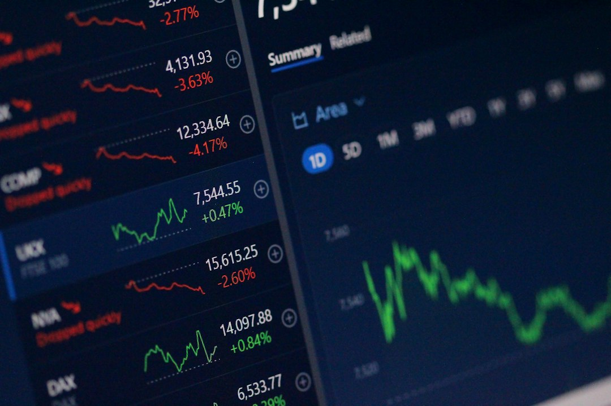

Có một loại trái phiếu trả lãi thấp hơn trái phiếu thường của cùng doanh nghiệp, vậy mà các quỹ lớn vẫn tranh nhau mua. Lý do nằm ở quyền đổi khoản cho vay thành cổ phiếu. Bài này của **[Value Investing](/)** giải thích **trái phiếu chuyển đổi là gì**, cách tính khi nào nên đổi và rủi ro pha loãng.

## Trái phiếu chuyển đổi là gì?

Theo khoản 3 Điều 4 Nghị định 153/2020/NĐ-CP, trái phiếu chuyển đổi là trái phiếu do công ty cổ phần phát hành. Người nắm giữ có thể đổi nó thành cổ phiếu phổ thông của chính công ty đó. Điều kiện đổi được ghi trong phương án phát hành.

Nói đơn giản hơn, đây là **[trái phiếu](/dau-tu/trai-phieu/trai-phieu-la-gi/)** gắn thêm một quyền chọn. Trước khi đổi, bạn là chủ nợ và nhận lãi định kỳ. Sau khi đổi, bạn thành cổ đông và khoản nợ gốc được xóa.

Hãy thử nghĩ thế này. Bạn cho chủ một quán cà phê vay 100 triệu đồng, lãi 5%/năm trong 3 năm. Hai bên thỏa thuận thêm: nếu quán làm ăn tốt, bạn được đổi khoản vay thành 20% cổ phần thay vì đòi tiền.

Nếu quán lỗ, bạn vẫn đòi lại 100 triệu như một người cho vay bình thường. Nếu quán đông khách và giá trị tăng gấp đôi, 20% cổ phần đáng giá hơn nhiều so với khoản vay gốc. Đó chính là logic của trái phiếu chuyển đổi.

## Cơ chế hoạt động của trái phiếu chuyển đổi

Mỗi lô trái phiếu chuyển đổi được định nghĩa bởi 4 thông số. Bạn cần tìm đủ 4 con số này trong phương án phát hành trước khi đánh giá bất cứ điều gì.

- **Mệnh giá**. Số tiền gốc của mỗi trái phiếu. Với lô chào bán riêng lẻ trong nước, Nghị định 65/2022/NĐ-CP nâng mệnh giá tối thiểu lên 100 triệu đồng.
- **Tỷ lệ chuyển đổi**. Số cổ phiếu nhận được khi đổi một trái phiếu, ví dụ 1 trái phiếu đổi 4.000 cổ phiếu.
- **Giá chuyển đổi**. Mức giá cổ phiếu ngầm định khi bạn đổi, bằng mệnh giá chia cho tỷ lệ chuyển đổi.
- **Thời điểm chuyển đổi**. Có thể là một ngày cố định, nhiều đợt trong năm, hoặc bất kỳ lúc nào sau một mốc thời gian.

Vòng đời của trái phiếu chuyển đổi đi qua 3 giai đoạn. Giai đoạn đầu, bạn giữ trái phiếu và nhận lãi coupon như mọi trái phiếu khác. Đến kỳ chuyển đổi, bạn so sánh giá cổ phiếu trên thị trường với giá chuyển đổi để quyết định.

Giai đoạn cuối là tất toán.

Nếu đổi, Tổng công ty Lưu ký và Bù trừ chứng khoán Việt Nam (VSDC) hủy trái phiếu. Cổ phiếu mới sau đó được ghi nhận vào tài khoản của bạn. Nếu không đổi, doanh nghiệp trả lại gốc bằng tiền khi đáo hạn.

## Cách tính giá trị chuyển đổi và điểm hòa vốn

Ba công thức dưới đây đủ để bạn tự đánh giá một lô trái phiếu chuyển đổi bằng máy tính điện thoại.

- **Giá chuyển đổi = Mệnh giá / Tỷ lệ chuyển đổi**
- **Giá trị chuyển đổi = Tỷ lệ chuyển đổi × Giá cổ phiếu hiện tại**
- **Phần bù chuyển đổi = (Giá chuyển đổi − Giá cổ phiếu hiện tại) / Giá cổ phiếu hiện tại**

Một ví dụ thực tế với số liệu giả định. Công ty cổ phần A phát hành trái phiếu chuyển đổi mệnh giá 100 triệu đồng, kỳ hạn 3 năm, lãi 5%/năm. Tỷ lệ chuyển đổi là 1 trái phiếu đổi 4.000 cổ phiếu, nên giá chuyển đổi là 100.000.000 / 4.000 = 25.000 đồng/cổ phiếu.

Lúc phát hành, cổ phiếu A đang giao dịch ở 20.000 đồng. Phần bù chuyển đổi là (25.000 − 20.000) / 20.000 = 25%. Nghĩa là cổ phiếu phải tăng ít nhất 25% thì quyền chuyển đổi mới bắt đầu có giá trị.

*Ảnh: Anne Nygård / Unsplash*

Đến ngày chuyển đổi cuối kỳ, kết quả phụ thuộc hoàn toàn vào giá cổ phiếu A lúc đó.

| Giá cổ phiếu A khi chuyển đổi | Giá trị nếu đổi (4.000 cổ phiếu) | Lựa chọn hợp lý | Bạn nhận được |
| :--- | :--- | :--- | :--- |
| 18.000 đồng | 72 triệu đồng | Không đổi, lấy gốc | 100 triệu + lãi 15 triệu |
| 25.000 đồng | 100 triệu đồng | Đổi hay không như nhau | 100 triệu + lãi 15 triệu |
| 35.000 đồng | 140 triệu đồng | Đổi sang cổ phiếu | 140 triệu + lãi 15 triệu |

Lãi 15 triệu là 5%/năm × 3 năm, chưa tính thuế. Bảng trên cho thấy phần đáy được bảo vệ bởi tiền gốc, còn phần đỉnh mở theo giá cổ phiếu.

### Điểm hòa vốn thực sự cao hơn giá chuyển đổi

Đây là chỗ nhiều người tính sai. Giả sử trái phiếu thường của công ty A cùng kỳ hạn trả 9%/năm. Chọn trái phiếu chuyển đổi, bạn chấp nhận mất 4%/năm, tức 12 triệu đồng sau 3 năm.

Vì vậy, giá trị chuyển đổi phải đạt ít nhất 112 triệu đồng mới bằng phương án mua trái phiếu thường. Tương ứng giá cổ phiếu A phải lên 28.000 đồng, cao hơn giá chuyển đổi 3.000 đồng. Dưới mức này, quyền chuyển đổi chưa bù được phần lãi bạn đã bỏ ra.

## So sánh trái phiếu chuyển đổi, trái phiếu thường và cổ phiếu

Trái phiếu chuyển đổi nằm ở giữa hai loại tài sản quen thuộc. Bảng dưới tóm tắt khác biệt về quyền lợi và rủi ro.

| Tiêu chí | Trái phiếu thường | Trái phiếu chuyển đổi | Cổ phiếu |
| :--- | :--- | :--- | :--- |
| Vai trò của bạn | Chủ nợ | Chủ nợ, có thể thành cổ đông | Cổ đông |
| Thu nhập | Lãi cố định | Lãi cố định thấp hơn + quyền đổi | Cổ tức (không cố định) |
| Hoàn gốc khi đáo hạn | Có | Có, nếu không đổi | Không có đáo hạn |
| Hưởng lợi khi cổ phiếu tăng | Không | Có, sau khi vượt giá chuyển đổi | Có |
| Thứ tự trả nợ khi phá sản | Trước cổ đông | Trước cổ đông (khi chưa đổi) | Sau cùng |
| Quyền biểu quyết | Không | Không, cho đến khi đổi | Có |

Nếu bạn mới làm quen với kênh này, bài [trái phiếu doanh nghiệp](/dau-tu/trai-phieu/trai-phieu-doanh-nghiep/) giải thích phần nền tảng về rủi ro tín dụng. Trái phiếu chuyển đổi mang toàn bộ rủi ro đó, cộng thêm rủi ro giá cổ phiếu.

## Trái phiếu chuyển đổi khác trái phiếu hoán đổi thế nào?

Hai khái niệm này hay bị dùng lẫn trên báo. Trái phiếu chuyển đổi đổi sang cổ phiếu của chính doanh nghiệp phát hành. Trái phiếu hoán đổi (exchangeable bond) đổi sang cổ phiếu của một công ty khác mà doanh nghiệp phát hành đang sở hữu.

Một ví dụ thực tế là lô trái phiếu quốc tế 500 triệu USD Vingroup phát hành năm 2021. Lô này kỳ hạn 5 năm, lãi 3%/năm, niêm yết tại Sở Giao dịch Chứng khoán Singapore. Theo Latham & Watkins, đơn vị tư vấn pháp lý, đây là trái phiếu hoán đổi sang cổ phiếu Vinhomes (VHM).

Điểm khác biệt này có ý nghĩa với cổ đông. Trái phiếu chuyển đổi tạo ra cổ phiếu mới và làm pha loãng cổ đông của chính công ty. Trái phiếu hoán đổi chỉ chuyển cổ phiếu sẵn có từ doanh nghiệp sang trái chủ, không tạo cổ phiếu mới.

## Vì sao doanh nghiệp chọn phát hành trái phiếu chuyển đổi?

Với doanh nghiệp, đây là cách vay rẻ hơn kèm một lời hứa. Lãi suất thấp hơn giúp giảm chi phí tài chính trong những năm đầu, khi dự án chưa ra tiền.

*Ảnh: Cytonn Photography / Unsplash*

Lý do thứ hai là bán cổ phiếu ở giá cao hơn hiện tại. Trong ví dụ trên, công ty A thực chất đang chào bán cổ phiếu ở giá 25.000 đồng khi thị trường chỉ trả 20.000 đồng. Nếu chuyển đổi xảy ra, khoản nợ biến mất mà không cần trả tiền mặt.

Lý do thứ ba ít được nói tới. Doanh nghiệp có tín nhiệm thấp đôi khi không vay được bằng trái phiếu thường với lãi suất hợp lý. Quyền chuyển đổi trở thành món ngọt để hút nhà đầu tư, và đây là tín hiệu bạn nên đọc kỹ báo cáo tài chính.

## Ưu và nhược điểm của trái phiếu chuyển đổi với nhà đầu tư

Trái phiếu chuyển đổi không tốt hơn hay kém hơn trái phiếu thường. Nó phù hợp với một kiểu kỳ vọng cụ thể: tin doanh nghiệp tăng trưởng nhưng vẫn muốn có tấm đệm.

**Ưu điểm**

- **Có sàn bảo vệ**. Nếu doanh nghiệp còn khả năng trả nợ, bạn nhận lại gốc dù cổ phiếu giảm.
- **Có trần mở**. Khi cổ phiếu tăng mạnh, lợi nhuận tăng theo gần như không giới hạn.
- **Ưu tiên trả nợ**. Khi chưa chuyển đổi, bạn được thanh toán trước cổ đông nếu doanh nghiệp giải thể.

**Nhược điểm**

- **Lãi suất thấp hơn**. Nếu cổ phiếu đi ngang 3 năm, bạn thu ít hơn người mua trái phiếu thường.
- **Rủi ro tín dụng vẫn còn**. Phần lớn lô không có tài sản bảo đảm, doanh nghiệp vỡ nợ thì sàn bảo vệ cũng mất.
- **Thanh khoản thấp**. Lô riêng lẻ khó bán lại trước hạn, giá chào mua thường bị ép.
- **Điều khoản phức tạp**. Một số lô có quyền mua lại trước hạn của doanh nghiệp hoặc điều chỉnh giá chuyển đổi, làm giảm phần lợi của bạn.

## Quy định về trái phiếu chuyển đổi tại Việt Nam

Khoản 3 Điều 9 Nghị định 153/2020/NĐ-CP đặt ra các điều kiện riêng cho chào bán riêng lẻ trái phiếu chuyển đổi. Văn bản này đã được sửa đổi bởi Nghị định 65/2022/NĐ-CP và các văn bản sau đó.

- **Doanh nghiệp phát hành**. Phải là công ty cổ phần.
- **Người mua**. Chỉ nhà đầu tư chứng khoán chuyên nghiệp hoặc dưới 100 nhà đầu tư chiến lược.
- **Lịch sử trả nợ**. Đã thanh toán đủ gốc, lãi trái phiếu đến hạn hoặc các khoản nợ đến hạn trong 3 năm liên tiếp trước đó.
- **Báo cáo tài chính**. Năm trước liền kề phải được kiểm toán bởi tổ chức kiểm toán đủ điều kiện.
- **Khoảng cách giữa các đợt**. Các đợt chào bán riêng lẻ trái phiếu chuyển đổi phải cách nhau ít nhất 6 tháng.
- **Sở hữu nước ngoài**. Việc chuyển đổi phải tuân thủ giới hạn tỷ lệ sở hữu của nhà đầu tư nước ngoài.

Điều này có nghĩa là gì với bạn trong thực tế? Nhà đầu tư cá nhân thông thường gần như không tiếp cận được lô riêng lẻ. Ai mời bạn mua lô riêng lẻ mà không hỏi tư cách nhà đầu tư chuyên nghiệp, đó là dấu hiệu cần dừng lại.

Bài [cách mua trái phiếu](/dau-tu/trai-phieu/cach-mua-trai-phieu/) liệt kê các kênh mua hợp pháp cho nhà đầu tư cá nhân.

## Cổ đông hiện hữu nên đọc tin phát hành trái phiếu chuyển đổi thế nào?

Với phần lớn F0, bạn sẽ gặp trái phiếu chuyển đổi qua một dòng tin trên bảng điện tử chứ không phải khi đi mua. Câu hỏi đúng lúc đó là: cổ phần của bạn bị pha loãng bao nhiêu?

Một ví dụ thực tế với số liệu giả định.

Công ty B có 100 triệu cổ phiếu đang lưu hành. Công ty phát hành 500 tỷ đồng trái phiếu chuyển đổi với giá chuyển đổi 25.000 đồng. Nếu toàn bộ được chuyển đổi, công ty phát hành thêm 20 triệu cổ phiếu mới.

Tổng số cổ phiếu lên 120 triệu, phần sở hữu của cổ đông cũ giảm từ 100% xuống 83,3%. Lợi nhuận không đổi thì EPS giảm khoảng 16,7%. Bài [pha loãng cổ phiếu](/dau-tu/co-phieu/pha-loang-co-phieu-la-gi/) hướng dẫn cách tính EPS pha loãng chi tiết hơn.

> **Lưu ý:** Doanh nghiệp có trái phiếu chuyển đổi đang lưu hành thường trình bày cả EPS cơ bản và EPS suy giảm. Khi định giá bằng P/E, hãy dùng EPS suy giảm để không đánh giá quá cao lợi nhuận trên mỗi cổ phiếu.

## Checklist 5 câu hỏi trước khi mua trái phiếu chuyển đổi

Nếu bạn đủ điều kiện và đang cân nhắc một lô cụ thể, hãy trả lời 5 câu hỏi sau. Trả lời bằng số liệu, không bằng cảm giác.

1. **Doanh nghiệp có trả được nợ nếu cổ phiếu không tăng**? Xem dòng tiền kinh doanh và tỷ lệ nợ trên vốn chủ sở hữu.
2. **Phần bù chuyển đổi là bao nhiêu phần trăm**? Phần bù càng cao, cổ phiếu càng phải tăng mạnh bạn mới có lợi.
3. **Điểm hòa vốn so với trái phiếu thường nằm ở đâu**? Tính phần lãi bỏ ra như ví dụ công ty A.
4. **Doanh nghiệp có quyền mua lại trước hạn không**? Điều khoản này có thể cắt mất phần lợi khi cổ phiếu tăng.
5. **Có tài sản bảo đảm hay không**? Không có thì sàn bảo vệ chỉ tốt bằng khả năng trả nợ của doanh nghiệp.

Bạn cũng nên so sánh lợi suất thực nhận với [bond yield](/dau-tu/trai-phieu/bond-yield-la-gi/) của trái phiếu chính phủ cùng kỳ hạn. Phần chênh lệch là mức bạn được trả cho rủi ro.

## Trái phiếu chuyển đổi phù hợp với ai?

Sự thật là trái phiếu chuyển đổi không phải công cụ an toàn hơn cổ phiếu cho F0. Nó dành cho người hiểu cả hai phía. Họ đọc được khả năng trả nợ của doanh nghiệp và có quan điểm về giá cổ phiếu trong 2–5 năm.

Nếu mới bắt đầu với kênh này, **[cách đầu tư trái phiếu](/dau-tu/trai-phieu/cach-dau-tu-trai-phieu/)** cho người mới là điểm xuất phát an toàn hơn.

Bước tiếp theo bạn có thể làm ngay: mở báo cáo tài chính gần nhất của một cổ phiếu bạn đang giữ. Tìm mục trái phiếu phát hành và EPS suy giảm, rồi tính thử mức pha loãng như ví dụ công ty B.

Bạn muốn đi sâu hơn về kênh này? Bài [có nên đầu tư trái phiếu](/dau-tu/trai-phieu/co-nen-dau-tu-trai-phieu/) giúp bạn đặt trái phiếu vào đúng vị trí trong danh mục.

> **Tuyên bố miễn trừ trách nhiệm:** Bài viết chỉ nhằm cung cấp kiến thức, không phải khuyến nghị mua, bán hay nắm giữ bất kỳ trái phiếu hoặc cổ phiếu nào. Các ví dụ về công ty A, công ty B dùng số liệu giả định. Bạn nên tự đánh giá hoặc tham khảo chuyên gia được cấp phép trước khi đầu tư.
